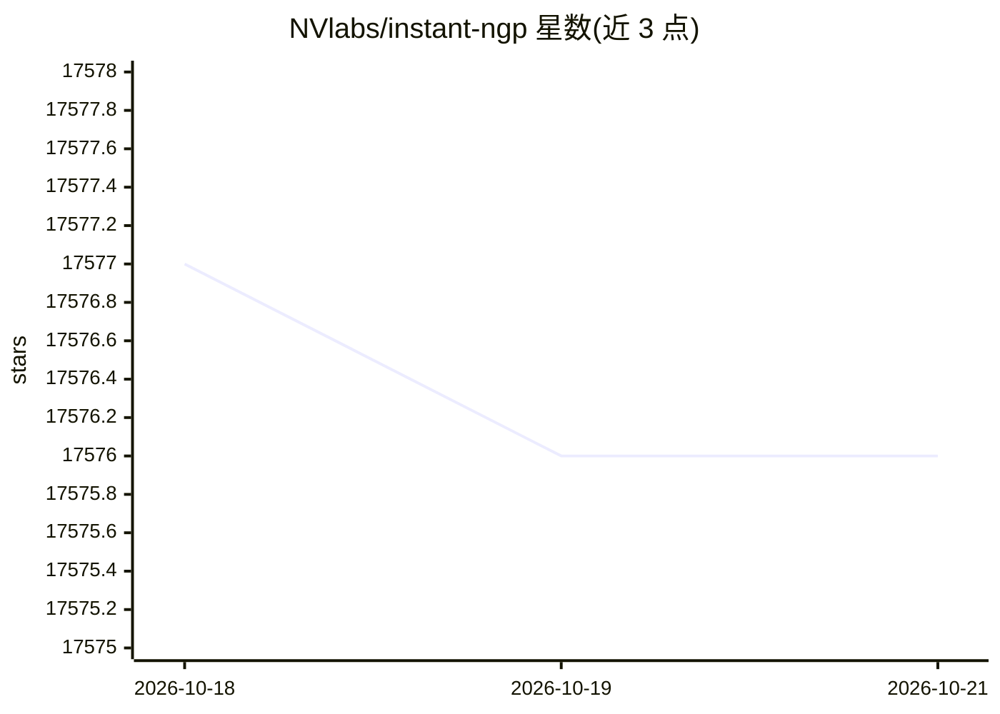

# NVlabs/instant-ngp

⭐ 17,576 · Cuda · NOASSERTION · 推送 2026-02-02 · [GitHub](https://github.com/NVlabs/instant-ngp) · [官网](https://nvlabs.github.io/instant-ngp) · 组织维护

**给 NeRF/图形研究者：用哈希编码 MLP 秒级训练并渲染神经图形基元**

实现四类神经图形基元：NeRF、符号距离函数（SDF）、神经图像与神经体渲染，核心是用多分辨率哈希输入编码训练 MLP，基于 tiny-cuda-nn 框架实现。提供交互式 GUI（VR 查看、相机路径编辑、NeRF/SDF 转网格、快照保存加载）与 Python 绑定。Windows 提供按显卡系列划分的预编译包，Linux 或需要开发者绑定时须自行用 CMake 编译，要求 NVIDIA GPU 与 CUDA。README 含数据集制作、故障排查 FAQ 与 Colab 示例指引。

## 筛选速览

| 维度 | 判定 | 备注 |
|---|---|---|
| AI 角色 | `ai-enhanced` | 去掉 AI 部分产品仍成立 |
| 许可风险 | `none` | NOASSERTION |
| 部署形态 | `desktop` | 安装包/桌面程序 |
| 模型依赖 | — | README 未给出锁定关系 |
| 硬件要求 | — | 无带数字的原话,不猜 |
| 安装摩擦 | `low` | 无编译、无系统依赖或容器化 |
| 成熟度 | — | 结构信号不足 |

## 动量与使用信号

- 维护:`declining` — 距上次 push 257.8 天,年发版 0,43 位贡献者
- 涨星:近 1 天 **+1**(自 20261016 起算)
- 平台:WINDOWS / LINUX · 协议:—

## 能力要点

- 支持 NeRF、SDF、神经图像、神经体四类基元的训练与渲染
- 多分辨率哈希输入编码 + tiny-cuda-nn 框架
- GUI 含 VR 模式、相机路径编辑、网格导出与快照管理
- 全部 GUI 功能均有 Python 绑定，可脚本化运行

## 适用场景

- 从照片集训练 NeRF 并渲染环绕视频
- 将 NeRF/SDF 模型转换为网格导出
- 通过 Python 绑定做自动化实验
- 在 VR 头显中查看训练好的场景

## 场景标签

 · 领域:计算机图形学/3D 重建

## 证据(README 行号)

> L5: Here you will find an implementation of four __neural graphics primitives__, being neural radiance fields (NeRF), si
> L6: In each case, we train and render a MLP with multiresolution hash input encoding using the __tiny-cuda-nn__ framewor
> L147: - __(optional) Python 3.8 or higher__ for interactive bindings. Also, run `pip install -r requirements.txt`.

## 星数曲线

2026-10-18 17,577 → 2026-10-21 17,576（-1）

---
*卡片 v1 · prompt 1.4 · 生成 2026-10-18 · 置信度 mid · 依据 README sha `31dfdc3a2127` · [字段定义](../../DATASET.md)*
