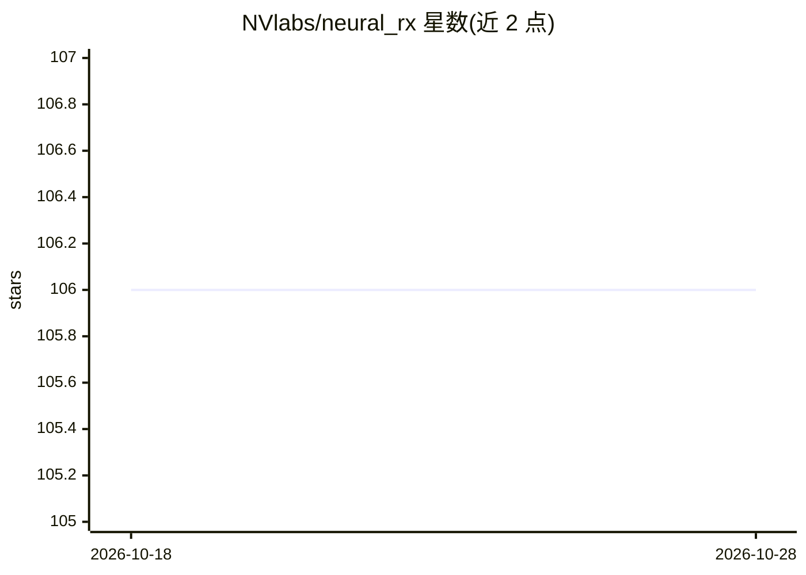

# NVlabs/neural_rx

⭐ 106 · Jupyter Notebook · NOASSERTION · 推送 2025-12-11 · [GitHub](https://github.com/NVlabs/neural_rx) · 组织维护

**5G NR 多用户 MIMO 神经接收机的设计训练与实时推理代码**

NVIDIA 实验室发布的科研代码库：基于 Sionna 链路级仿真库与 TensorFlow，设计、训练并评估 5G NR PUSCH 多用户 MIMO 神经接收机（CGNN 架构），联合执行信道估计、均衡与解映射，支持可变 PRB/用户数/MCS。训练后的模型可经 TensorRT/ONNX 导出用于实时推理，论文报告在 NVIDIA A100 GPU 上 1 ms 内完成推理。提供教程 notebook、预训练权重与训练/评估脚本。运行要求 Sionna 0.18、Python 3.10、TensorFlow 2.15，推荐 Ubuntu 22.04。已在 MWC 2023/2024 做演示。

## 筛选速览

| 维度 | 判定 | 备注 |
|---|---|---|
| AI 角色 | `ai-native` | 本体是模型或模型工具 |
| 许可风险 | `none` | NOASSERTION |
| 部署形态 | `None` |  |
| 模型依赖 | — | README 未给出锁定关系 |
| 硬件要求 | — | 无带数字的原话,不猜 |
| 安装摩擦 | `low` | 无编译、无系统依赖或容器化 |
| 成熟度 | — | 结构信号不足 |

## 能力要点

- 5G NR 兼容的多用户 MIMO PUSCH 神经接收机（CGNN 架构）
- TensorRT / ONNX 模型导出，用于实时推理
- 可变 PRB/用户数/MCS，无需重新训练
- 基于 SionnaRT 光线追踪的站点特定训练

## 适用场景

- 研究 5G NR 神经接收机的端到端训练与评估
- 复现论文中的实时推理实验
- 站点特定场景下训练接收机模型

## 场景标签

`模型训练` · 领域:训练与推理

## 证据(README 行号)

> L3: The code in this repository allows to design, train, and evaluate [neural
> L31: We introduce a neural network (NN)-based multi-user multiple-input
> L44: such that the receiver can be executed within 1 ms latency on an NVIDIA A100

## 星数曲线

2026-10-18 106 → 2026-10-28 106（+0）

---
*卡片 v1 · prompt 1.4 · 生成 2026-10-23 · 置信度 high · 依据 README sha `516c2496a0d5` · [字段定义](../../DATASET.md)*
