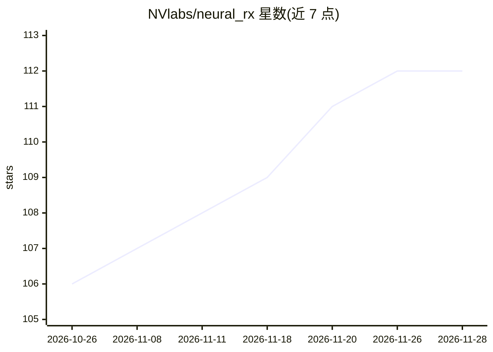

# NVlabs/neural_rx

⭐ 112 · Jupyter Notebook · NOASSERTION · 推送 2026-11-25 · [GitHub](https://github.com/NVlabs/neural_rx) · 组织维护

**5G NR 多用户 MIMO 神经接收机的 PyTorch 训练与部署库**

提供 5G NR 多用户 MIMO 神经接收机的 PyTorch 实现，覆盖设计、训练、评估与导出：接收机对完整 PUSCH OFDM 时隙联合执行信道估计、均衡与解映射，支持多用户 MIMO、UMi/UMa/TDL/AWGN/Sionna RT 信道模型、载波频偏、可变激活用户数、站点级微调与免导频端到端星座学习。训练好的接收机可导出 ONNX 用于实时推理，并支持 Aerial/TensorRT 部署。提供 neural-rx CLI 完成训练、评估与导出，附预训练检查点与教程 notebook。

## 筛选速览

| 维度 | 判定 | 备注 |
|---|---|---|
| AI 角色 | `ai-native` | 本体是模型或模型工具 |
| 许可风险 | `none` | NOASSERTION |
| 部署形态 | `library` | 以包/库形式分发 |
| 模型依赖 | — | README 未给出锁定关系 |
| 硬件要求 | — | 无带数字的原话,不猜 |
| 安装摩擦 | `medium` | 含编译或系统依赖之一 |
| 成熟度 | — | 结构信号不足 |

## 能力要点

- 对 PUSCH OFDM 时隙联合执行信道估计、均衡与解映射
- 支持多用户 MIMO、UMi/UMa/TDL/AWGN/Sionna RT 信道与载波频偏
- 导出 ONNX，含 Aerial 兼容 profile 与 TensorRT 部署基准
- 提供预训练检查点、多组实验配置与教程 notebook

## 适用场景

- 训练并评估 5G NR 神经接收机的 BER/BLER 性能
- 将接收机导出 ONNX 并在 TensorRT 上做实时推理
- 基于 Sionna RT 射线追踪数据做站点级微调

## 场景标签

`微调` `模型训练` · 领域:训练与推理

## 证据(README 行号)

> L10: This repository provides PyTorch implementations for designing, training, and
> L15: The receiver operates on a complete PUSCH OFDM slot and jointly performs channel

## 星数曲线

2026-10-26 106 → 2026-11-28 112（+6）

---
*卡片 v1 · prompt 1.4 · 生成 2026-11-28 · 置信度 high · 依据 README sha `5d5fb391f99a` · [字段定义](../../DATASET.md)*
