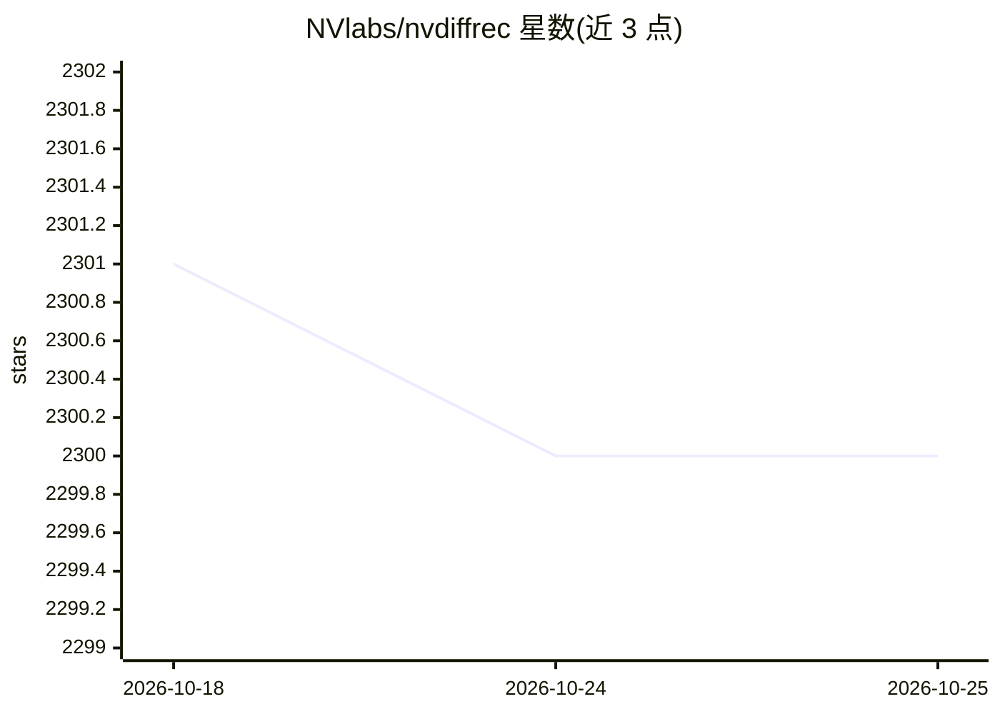

# NVlabs/nvdiffrec

⭐ 2,300 · Python · NOASSERTION · 推送 2026-08-12 · [GitHub](https://github.com/NVlabs/nvdiffrec) · 组织维护

**CVPR 2022 论文官方代码：从多视角图像重建三角网格 3D 模型、材质与光照**

NVIDIA 实验室发布的论文官方实现，通过联合优化拓扑、材质与光照，从多视角图像观测中提取三角网格 3D 模型。基于 PyTorch 与可微 marching tetrahedra（改编自 Kaolin），支持 FlexiCubes 等值面技术，另提供 slangpy 版 renderutils 分支。面向 3D 重建/图形学研究者复现论文结果，需 CUDA 11.3+ 与高端 NVIDIA GPU，中低端 GPU 需减小 batch size。含示例配置与数据集自动下载脚本，支持 Windows/Linux 与 Docker 运行。

## 筛选速览

| 维度 | 判定 | 备注 |
|---|---|---|
| AI 角色 | `ai-native` | 本体是模型或模型工具 |
| 许可风险 | `none` | NOASSERTION |
| 部署形态 | `self-host` | docker 或自建部署 |
| 模型依赖 | — | README 未给出锁定关系 |
| 硬件要求 | — | 无带数字的原话,不猜 |
| 安装摩擦 | `low` | 无编译、无系统依赖或容器化 |
| 成熟度 | — | 结构信号不足 |

## 能力要点

- 拓扑、材质、光照联合优化，输出三角网格 3D 模型
- 可微 marching tetrahedra（改编自 NVIDIA Kaolin）
- 支持 FlexiCubes 等值面技术（configs/bob_flexi.json）
- slang 分支提供 slangpy 版 renderutils，替代手写 CUDA 前向/反向

## 适用场景

- 复现论文的 3D 重建与视图插值结果
- 从多视角图像提取带材质与光照的 3D 模型
- 作为可微渲染/重建研究的代码基础

## 场景标签

 · 领域:计算机图形学/3D 重建

## 证据(README 行号)

> L5: Joint optimization of topology, materials and lighting from multi-view image observations
> L53: *Our approach is designed for high-end NVIDIA GPUs with large amounts of memory.

## 星数曲线

2026-10-18 2,301 → 2026-10-25 2,300（-1）

---
*卡片 v1 · prompt 1.4 · 生成 2026-10-21 · 置信度 high · 依据 README sha `1f3927313fda` · [字段定义](../../DATASET.md)*
