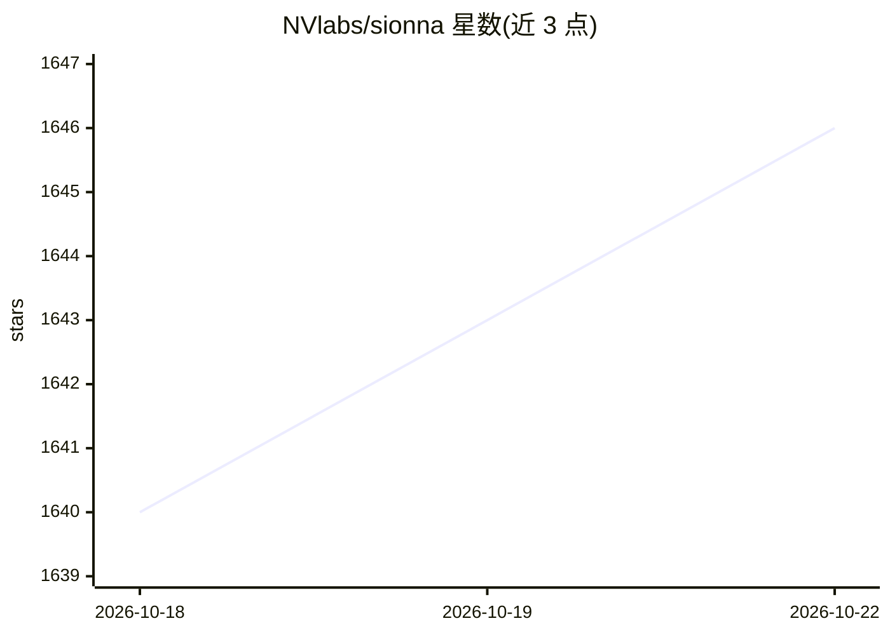

# NVlabs/sionna

⭐ 1,648 · Jupyter Notebook · NOASSERTION · 推送 2026-10-20 · [GitHub](https://github.com/NVlabs/sionna) · [官网](https://nvlabs.github.io/sionna/) · 组织维护

**面向通信系统研究的可微仿真库（光线追踪/链路级/系统级）**

NVIDIA 实验室开源的 Python 通信系统研究库，含三个包：Sionna RT 独立光线追踪器用于无线电传播建模，Sionna PHY 无线与光通信链路级仿真器，Sionna SYS 基于物理层抽象的系统级仿真器。基于 PyTorch 实现可微仿真，支持 GPU（CUDA）加速，教程 notebook 可在 Google Colab 运行。要求 Python 3.11+ 与 PyTorch 2.9+，推荐 Ubuntu 24.04；Sionna RT 源码位于独立仓库，CPU 运行需 LLVM 后端。Apache-2.0 许可。

## 筛选速览

| 维度 | 判定 | 备注 |
|---|---|---|
| AI 角色 | `ai-native` | 本体是模型或模型工具 |
| 许可风险 | `none` | NOASSERTION |
| 部署形态 | `library` | 以包/库形式分发 |
| 模型依赖 | — | README 未给出锁定关系 |
| 硬件要求 | — | 无带数字的原话,不猜 |
| 安装摩擦 | `medium` | 含编译或系统依赖之一 |
| 成熟度 | — | 结构信号不足 |

## 能力要点

- 三个包：RT 光线追踪、PHY 链路级仿真、SYS 系统级仿真
- 基于 PyTorch 的可微仿真与 GPU 加速
- 推荐 Docker/虚拟环境运行，教程可在 Colab 打开
- pip 提供三种安装变体（sionna / sionna-rt / sionna-no-rt）

## 适用场景

- 无线信道建模与无线电传播光线追踪仿真
- 5G/6G 物理层链路级仿真研究
- 基于机器学习的通信系统研究（可微仿真）

## 场景标签

 · 领域:通信系统/无线网络仿真

## 证据(README 行号)

> L3: Sionna&trade; is an open-source Python-based library for research on
> L11: - Sionna RT -
> L15:  A link-level simulator for wireless and optical communication systems
> L17: - Sionna SYS -
> L21: Sionna PHY and Sionna SYS require Python 3.11+ and PyTorch 2.9+. We recommend Ubuntu 24.04. Earlier versions of PyT

## 星数曲线

2026-10-18 1,640 → 2026-10-22 1,646（+6）

---
*卡片 v1 · prompt 1.4 · 生成 2026-10-21 · 置信度 high · 依据 README sha `5a3aa7381a36` · [字段定义](../../DATASET.md)*
