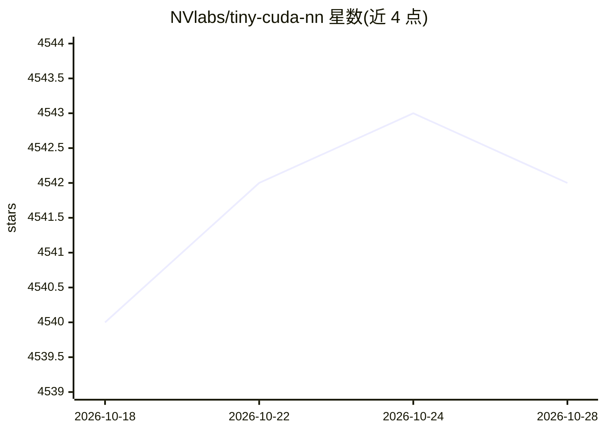

# NVlabs/tiny-cuda-nn

⭐ 4,542 · C++ · NOASSERTION · 推送 2026-09-29 · [GitHub](https://github.com/NVlabs/tiny-cuda-nn) · 组织维护

**面向 CUDA GPU 的轻量神经网络训练/查询 C++ 框架**

自包含的 C++/CUDA 神经网络框架，核心组件包括全融合 MLP、多分辨率哈希编码等多种输入编码、多种损失函数与优化器（Adam/Novograd/SGD）。提供 C++/CUDA API 与 PyTorch 绑定（tinycudann），v2.0 起支持可选的 JIT 融合特性，可将模型转为 CUDA device function 编译进单个 kernel。要求 NVIDIA GPU、C++17 编译器、CUDA 与 CMake 3.21+，通过 CMake 源码编译安装。

## 筛选速览

| 维度 | 判定 | 备注 |
|---|---|---|
| AI 角色 | `ai-ecosystem` | LLM/agent 周边工具 |
| 许可风险 | `none` | NOASSERTION |
| 部署形态 | `library` | 以包/库形式分发 |
| 模型依赖 | — | README 未给出锁定关系 |
| 硬件要求 | — | 无带数字的原话,不猜 |
| 安装摩擦 | `high` | 编译与系统依赖俱全 |
| 成熟度 | — | 结构信号不足 |

## 能力要点

- 全融合 MLP 与 CUTLASS MLP 两种网络实现
- 多分辨率哈希编码（用于 Instant NGP）等 8 种输入编码
- v2.0 起支持 JIT 融合，可将模型编译进应用 kernel
- 提供 PyTorch 扩展（tinycudann）从 Python 调用

## 适用场景

- 构建需要实时 MLP 推理/训练的 CUDA 应用（如 NeRF）
- 在 Python/PyTorch 中使用快速哈希编码与 MLP
- 将神经网络 fused 进自定义 CUDA kernel 以提升性能

## 场景标签

`推理引擎` · 领域:训练与推理

## 证据(README 行号)

> L3: This is a small, self-contained framework for training and querying neural networks. Most notably, it contains a lig
> L133: __tiny-cuda-nn__ comes with a PyTorch extension that allows using the fast MLPs and input encodings from within a 

## 星数曲线

2026-10-18 4,540 → 2026-10-28 4,542（+2）

---
*卡片 v1 · prompt 1.4 · 生成 2026-10-20 · 置信度 high · 依据 README sha `c208edbe36dd` · [字段定义](../../DATASET.md)*
