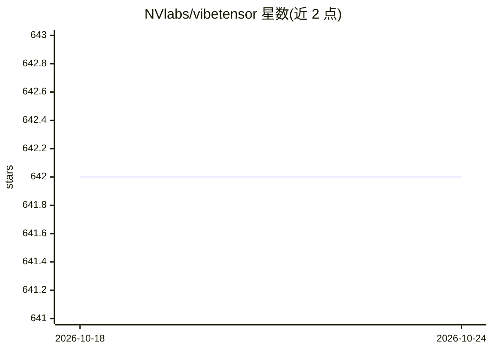

# NVlabs/vibetensor

⭐ 642 · Python · Apache-2.0 · 推送 2026-02-02 · [GitHub](https://github.com/NVlabs/vibetensor) · [官网](https://arxiv.org/abs/2601.16238) · 组织维护

**由 AI agent 全程生成的深度学习系统软件研究原型**

NVIDIA 实验室发布的研究产物：一个由 LLM 编程 agent 在高层人类指导下生成的深度学习 eager 运行时，包含 C++20 核心（CPU+CUDA）、torch 风格 Python 覆盖层与实验性 Node.js/TypeScript API，自行实现 tensor/storage、dispatcher、autograd、CUDA 运行时与缓存分配器、plugin ABI，支持 DLPack 互操作与 Triton 内核桥接。定位为 agentic system 研究，README 明确声明勿用于生产、性能不及 PyTorch，需 CUDA 与源码编译。

## 筛选速览

| 维度 | 判定 | 备注 |
|---|---|---|
| AI 角色 | `ai-ecosystem` | LLM/agent 周边工具 |
| 许可风险 | `permissive` | Apache-2.0 |
| 部署形态 | `library` | 以包/库形式分发 |
| 模型依赖 | — | README 未给出锁定关系 |
| 硬件要求 | — | 无带数字的原话,不猜 |
| 安装摩擦 | `high` | 编译与系统依赖俱全 |
| 成熟度 | `idea` | |

## 能力要点

- 实现自有 C++20 核心：dispatcher、反向 autograd、CUDA 流/缓存分配器、CUDA Graph 捕获回放
- Python 与 Node.js 双前端经 N-API/nanobind 汇入同一 C++ 算子注册表
- 扩展点：Python overrides、C/CUDA 插件（稳定 C ABI）、Triton 桥接、CuTeDSL 运行时
- 实验性多 GPU：Fabric tensors 与 CUTLASS Blackwell ring allreduce 插件

## 适用场景

- 研究 AI agent 能否生成并验证覆盖 Python/JS 绑定到 CUDA 分配器的完整系统栈
- 以构建/测试/差分检查而非人工逐行审查驱动代码正确性的方法论验证
- 探索 torch 风格 API 与插件化算子扩展机制的系统软件实验平台

## 场景标签

 · 领域:深度学习系统/系统软件研究

## 证据(README 行号)

> L8: VIBETENSOR is an open-source systems research artifact generated by LLM-powered coding agents under high-level human
> L16: Unlike “thin wrappers”, VibeTensor implements its own tensors/storage, dispatcher, autograd engine, CUDA runtime + 

## 星数曲线

2026-10-18 642 → 2026-10-24 642（+0）

---
*卡片 v1 · prompt 1.4 · 生成 2026-10-21 · 置信度 high · 依据 README sha `ddaa4d572777` · [字段定义](../../DATASET.md)*
