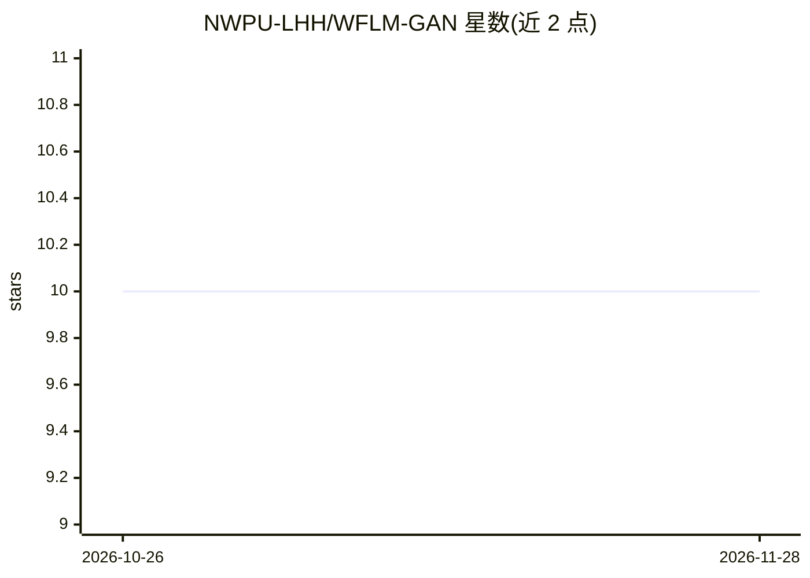

# NWPU-LHH/WFLM-GAN

⭐ 10 · Python · NOASSERTION · 推送 2026-08-10 · [GitHub](https://github.com/NWPU-LHH/WFLM-GAN) · 组织维护 · 中文 README

**面向研究者的 SAR 图像转光学图像 GAN 模型实现**

WFLM-GAN 的官方 PyTorch 代码实现，用于将 SAR 图像翻译为保留关键内容且具光学风格的光学图像。生成器学习 SAR 到小波特征的映射再重建灰度图，配合基于细节与风格学习的多尺度着色网络输出彩色图像。仓库附带项目所用 SEN1-2 数据集下载地址（百度网盘），给出依赖安装、conda 环境构建、训练、测试与 SSIM/PSNR 评估命令。面向开展 SAR-光学数据融合与图像翻译研究的研究者。

## 筛选速览

| 维度 | 判定 | 备注 |
|---|---|---|
| AI 角色 | `ai-native` | 本体是模型或模型工具 |
| 许可风险 | `none` | NOASSERTION |
| 部署形态 | `library` | 以包/库形式分发 |
| 模型依赖 | — | README 未给出锁定关系 |
| 硬件要求 | — | 无带数字的原话,不猜 |
| 安装摩擦 | `low` | 无编译、无系统依赖或容器化 |
| 成熟度 | — | 结构信号不足 |

## 能力要点

- 小波特征学习 + 多尺度着色网络的 SAR-to-Optical 翻译架构
- 提供 SEN1-2 数据集（282,384 对图像块）下载链接
- 提供训练、测试与 SSIM/PSNR/FID/KID 评估脚本
- 官方代码实现，模型结构文件开放可查

## 适用场景

- 将 SAR 遥感图像转换为光学风格图像辅助判读
- 在 SEN1-2 数据集上复现并训练图像翻译模型
- 对 SAR-to-optical 翻译结果做 SSIM/PSNR 指标评估

## 场景标签

`图像生成` · 领域:内容生成

## 证据(README 行号)

> L7: The synthetic aperture radar (SAR) system is a kind of active remote sensing, which can be carried on a variety of f
> L169: 1. the official code implementation of WFLM-GAN.

## 星数曲线

2026-10-26 10 → 2026-11-28 10（+0）

---
*卡片 v1 · prompt 1.4 · 生成 2026-11-20 · 置信度 high · 依据 README sha `a8f6613b13d0` · [字段定义](../../DATASET.md)*
