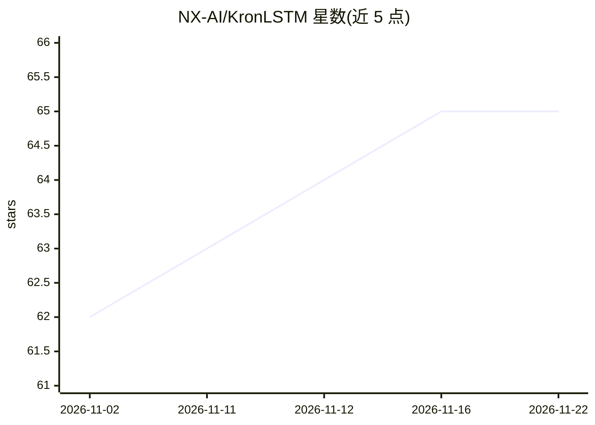

# NX-AI/KronLSTM

⭐ 65 · Python · MIT · 推送 2026-10-20 · [GitHub](https://github.com/NX-AI/KronLSTM) · 组织维护

**KronLSTM：线性注意力模型与 Triton 内核，服务长上下文建模**

论文《Kronecker Delta Rule for Long Context Linear Attention》的官方实现：提供 KronLSTM 线性注意力循环层的 Triton 内核与 PyTorch 层，状态沿 Kronecker 秩一键值对写入，训练用 chunkwise WY/UT 形式。包复用 FLA 的 `fla` 导入名并替换同环境中的 FLA。提供 1.5B、各 100B token 训练的 8K/32K 上下文预训练模型（含混合滑动窗口注意力版本）。开发测试仅在 Hopper/Ampere GPU 上进行，其他后端未测试；无上下文并行，内核头维存在上限。

## 筛选速览

| 维度 | 判定 | 备注 |
|---|---|---|
| AI 角色 | `ai-native` | 本体是模型或模型工具 |
| 许可风险 | `permissive` | MIT |
| 部署形态 | `library` | 以包/库形式分发 |
| 模型依赖 | — | README 未给出锁定关系 |
| 硬件要求 | — | 无带数字的原话,不猜 |
| 安装摩擦 | `medium` | 含编译或系统依赖之一 |
| 成熟度 | `idea` | |

## 能力要点

- Triton 内核 chunk_kronlstm 与 fused_recurrent_kronlstm（训练/解码）
- Hugging Face Hub 上的 1.5B 预训练模型（8K 与 32K 上下文，纯 KronLSTM 与混合注意力）
- 兼容 transformers Auto 类与 FLA 的层/配置接口
- 提供测试与基准脚本（对比 chunk_kda、chunk_gdn2）

## 适用场景

- 加载预训练模型或从头训练长上下文语言模型
- 在自研架构中用 KronLSTM 层替换注意力
- 运行 Triton 内核做长序列训练与解码基准

## 场景标签

`模型训练` · 领域:训练与推理

## 证据(README 行号)

> L6: Triton kernels and a PyTorch layer for KronLSTM, from the paper *Kronecker Delta Rule for Long Context Linear Attent
> L26: The paper's language models, each trained on 100B tokens with the Llama-2 tokenizer, are on the Hugging Face Hub:

## 星数曲线

2026-11-02 62 → 2026-11-22 65（+3）

---
*卡片 v1 · prompt 1.4 · 生成 2026-11-18 · 置信度 mid · 依据 README sha `fb97f2130a22` · [字段定义](../../DATASET.md)*
