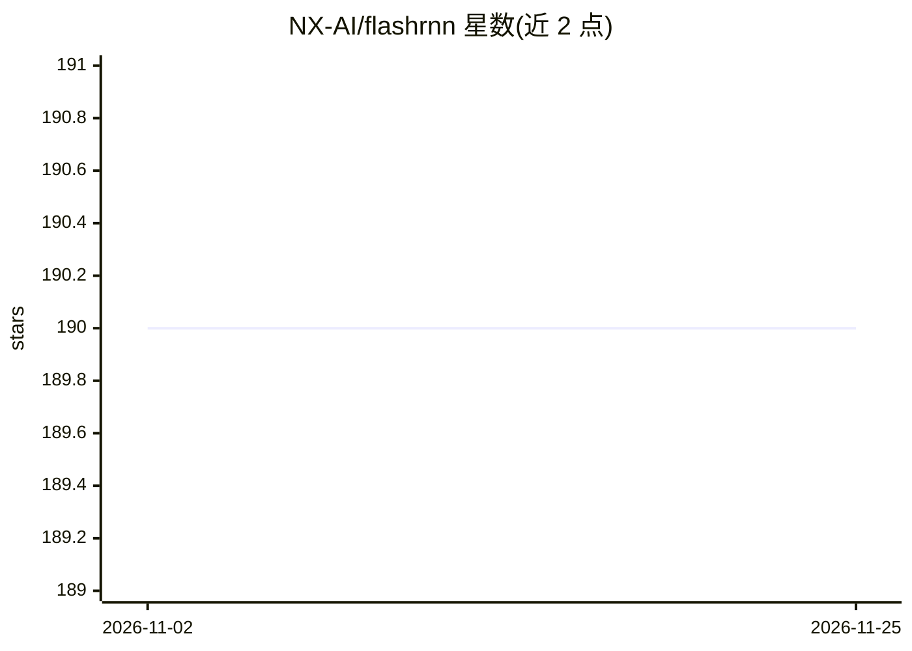

# NX-AI/flashrnn

⭐ 190 · Python · Apache-2.0 · 推送 2026-11-06 · [GitHub](https://github.com/NX-AI/flashrnn) · 组织维护

**给深度学习研究者的传统 RNN 高速 CUDA/Triton 核函数库**

NX-AI 出品（Pöppel、Beck、Hochreiter）的 PyTorch 扩展库，以 CUDA 与 Triton 实现 LSTM、GRU、Elman 网络及 sLSTM 等带状态追踪的循环结构。提供三种后端：Triton 融合版（head 维度≤64）、CUDA 交替版（head 维度不限）、CUDA 融合版（用 wmma 指令与 SRAM/寄存器缓存，官方称较交替版提速 2-5 倍）。采用函数式接口，参数不与 flashrnn 函数绑定。硬件要求 CUDA Compute Capability 8.0 及以上，安装依赖 pip，配有 conda 环境文件。Apache-2.0 许可，附 ICML 论文引用条目。

## 筛选速览

| 维度 | 判定 | 备注 |
|---|---|---|
| AI 角色 | `ai-native` | 本体是模型或模型工具 |
| 许可风险 | `permissive` | Apache-2.0 |
| 部署形态 | `library` | 以包/库形式分发 |
| 模型依赖 | — | README 未给出锁定关系 |
| 硬件要求 | — | 无带数字的原话,不猜 |
| 安装摩擦 | `medium` | 含编译或系统依赖之一 |
| 成熟度 | — | 结构信号不足 |

## 能力要点

- CUDA 与 Triton 实现 LSTM/GRU/Elman/sLSTM 核函数
- cuda_fused 后端使用 wmma 指令与 SRAM/寄存器自定义缓存
- 函数式接口，参数不绑定到调用函数
- 官方称融合 CUDA 版较交替版提速 2-5 倍

## 适用场景

- 在 GPU 上加速训练或运行 LSTM/GRU/sLSTM 模型
- 序列建模任务中需要状态追踪能力的循环层
- 替换慢速的 PyTorch 原生 RNN 实现

## 场景标签

`推理引擎` · 领域:训练与推理

## 证据(README 行号)

> L6: FlashRNN implements traditional RNNs like LSTMs, GRUs and Elman networks as well as the recent sLSTM architecture in
> L33: Your hardware needs to support CUDA Compute Capability $8.0$ or later. Make sure, you have an up to date `g++` comp

## 星数曲线

2026-11-02 190 → 2026-11-25 190（+0）

---
*卡片 v1 · prompt 1.4 · 生成 2026-11-17 · 置信度 high · 依据 README sha `49e49a87d8c7` · [字段定义](../../DATASET.md)*
