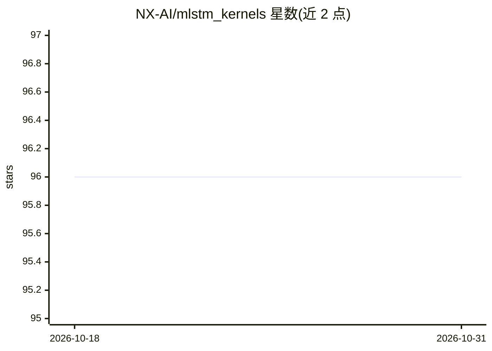

# NX-AI/mlstm_kernels

⭐ 96 · Jupyter Notebook · NOASSERTION · 推送 2026-09-14 · [GitHub](https://github.com/NX-AI/mlstm_kernels) · [官网](https://arxiv.org/abs/2503.14376) · 组织维护

**面向 xLSTM/mLSTM 的高效 Triton 训练与推理内核库**

NX-AI 维护的 mLSTM（矩阵 LSTM）内核库，提供 JAX、PyTorch 原生实现及 Triton 内核三类模块，覆盖 chunkwise、parallel、recurrent 三种处理方式，其中 chunkwise 内核基于 Tiled Flash Linear Attention（TFLA）论文。附带可配置 PyTorch backend 模块便于集成到自有模型（即 xLSTM 7B 官方实现的接入方式），并含运行时与显存基准测试库、单元测试及 HuggingFace 模型。通过 pip 安装；运行 kernel 基准需要大显存 GPU，JAX 测试仅在 NVIDIA H100 上验证过。

## 筛选速览

| 维度 | 判定 | 备注 |
|---|---|---|
| AI 角色 | `ai-ecosystem` | LLM/agent 周边工具 |
| 许可风险 | `none` | NOASSERTION |
| 部署形态 | `library` | 以包/库形式分发 |
| 模型依赖 | — | README 未给出锁定关系 |
| 硬件要求 | — | 无带数字的原话,不猜 |
| 安装摩擦 | `medium` | 含编译或系统依赖之一 |
| 成熟度 | — | 结构信号不足 |

## 能力要点

- JAX / PyTorch / Triton 三类 mLSTM 实现，含 chunkwise、parallel、recurrent 内核
- 可配置 backend 模块，自动在训练与推理内核间切换
- 附带可扩展的 kernel/模型运行时与显存基准测试库
- 内核间数值一致性交叉验证的单元测试

## 适用场景

- 在我的语言模型中集成 mLSTM 层并切换训练/推理内核
- 复现或扩展 TFLA / xLSTM 7B 论文的 kernel 基准测试
- 对比不同 mLSTM 内核实现的运行时间与显存占用

## 场景标签

 · 领域:深度学习/高效内核

## 证据(README 行号)

> L10: This library provides fast and efficient mLSTM training and inference Triton kernels.
> L13: This repository also contains an easy to extend library for any kind of runtime benchmarks, which we use to benchma

## 星数曲线

2026-10-18 96 → 2026-10-31 96（+0）

---
*卡片 v1 · prompt 1.4 · 生成 2026-10-23 · 置信度 high · 依据 README sha `ad0d95e620e1` · [字段定义](../../DATASET.md)*
