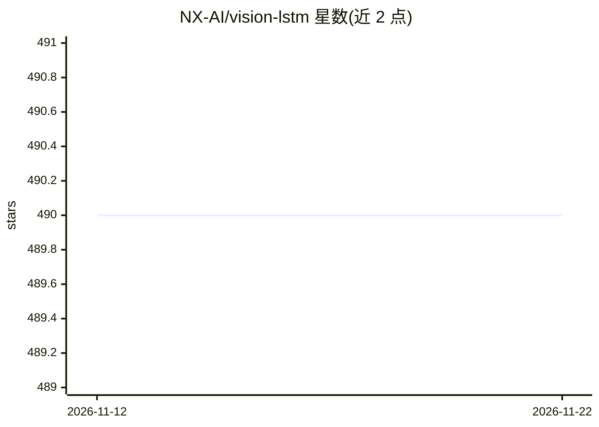

# NX-AI/vision-lstm

⭐ 490 · Python · Apache-2.0 · 推送 2026-11-06 · [GitHub](https://github.com/NX-AI/vision-lstm) · 组织维护

**xLSTM 视觉骨干网络 ViL 的 PyTorch 实现与预训练模型**

NX-AI 维护的 Vision-LSTM (ViL) 官方代码库：将 xLSTM 适配为通用计算机视觉骨干，提供 timm 风格的独立架构实现与完整训练/评测流水线。ImageNet-1K 预训练模型（vil2-tiny 至更大规模）可经 torch.hub 一行加载，覆盖图像分类与语义分割任务；另提供 DeiT-III-T 复现检查点（需额外安装 kappamodules）。训练流程说明分置于 SETUP.md 与 RUN.md，配置与超参公开，VTAB-1K 评测基于此代码库完成。

## 筛选速览

| 维度 | 判定 | 备注 |
|---|---|---|
| AI 角色 | `ai-native` | 本体是模型或模型工具 |
| 许可风险 | `permissive` | Apache-2.0 |
| 部署形态 | `library` | 以包/库形式分发 |
| 模型依赖 | — | README 未给出锁定关系 |
| 硬件要求 | — | 无带数字的原话,不猜 |
| 安装摩擦 | `low` | 无编译、无系统依赖或容器化 |
| 成熟度 | — | 结构信号不足 |

## 能力要点

- timm 风格的独立架构实现，可 torch.hub 一行加载
- ImageNet-1K 预训练模型（ViL2 系列，tiny 达 78.3%）
- 完整训练/评测流水线，含分类与语义分割配置
- 提供 DeiT-III-T 复现检查点（需 pip 安装 kappamodules）

## 适用场景

- 在图像分类或分割任务中使用 ViL 骨干网络
- 复现论文训练与 VTAB-1K 评测结果
- 研究 xLSTM 架构在视觉任务中的表现

## 场景标签

`目标检测` `模型训练` · 领域:感知与多模态

## 证据(README 行号)

> L9: Pytorch implementation and pre-trained models of Vision-LSTM (ViL), an adaption of xLSTM to computer vision.
> L43: ## Full training/eval pipeline (architecture, datasets, hyperparameters, classification, segmentation, ...)

## 星数曲线

2026-11-12 490 → 2026-11-22 490（+0）

---
*卡片 v1 · prompt 1.4 · 生成 2026-11-17 · 置信度 mid · 依据 README sha `dfb9156da76a` · [字段定义](../../DATASET.md)*
