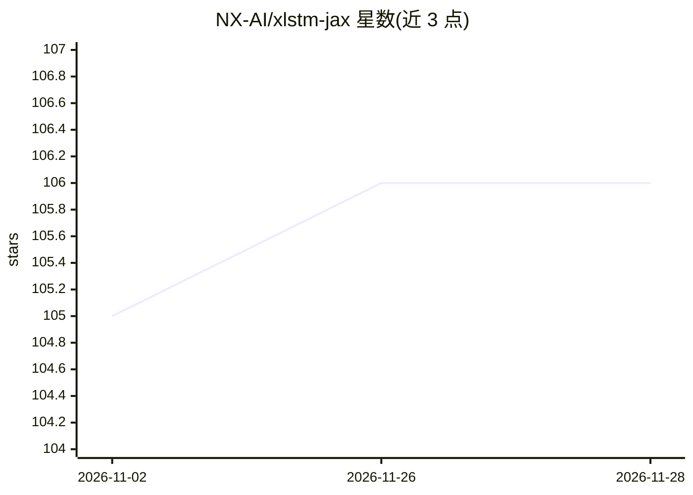

# NX-AI/xlstm-jax

⭐ 106 · Python · NOASSERTION · 推送 2026-11-06 · [GitHub](https://github.com/NX-AI/xlstm-jax) · [官网](https://xlstm-jax.readthedocs.io/en/latest/) · 组织维护

**xLSTM 循环神经网络架构的官方 JAX 训练与推理实现**

NX-AI 维护的 xLSTM 模型官方 JAX 代码库，提供在语言建模任务上训练与评估 xLSTM 的代码。xLSTM 是基于原 LSTM 思想的新循环神经网络架构，引入指数门控与矩阵记忆。代码库支持 3D 并行化策略，面向数百到数千 GPU 的大规模分布式训练优化，并开发了 Triton 内核以加快训练与推理。作者用其训练了 7B 参数模型（256 张 H100）。文档覆盖安装、数据准备、训练与 Hydra 配置。

## 筛选速览

| 维度 | 判定 | 备注 |
|---|---|---|
| AI 角色 | `ai-native` | 本体是模型或模型工具 |
| 许可风险 | `none` | NOASSERTION |
| 部署形态 | `None` |  |
| 模型依赖 | — | README 未给出锁定关系 |
| 硬件要求 | — | 无带数字的原话,不猜 |
| 安装摩擦 | `low` | 无编译、无系统依赖或容器化 |
| 成熟度 | — | 结构信号不足 |

## 能力要点

- xLSTM 架构的训练与推理代码（指数门控、矩阵记忆）
- 支持 3D 并行化，面向大规模分布式 GPU 训练
- 自研 Triton 内核提升训练与推理速度
- 已用于训练 7B 参数模型（256 张 H100）

## 适用场景

- 在语言建模任务上训练 xLSTM 模型
- 研究循环神经网络新架构与 Transformer/SSM 的对比
- 大规模分布式环境下进行 LLM 训练实验

## 场景标签

`模型训练` · 领域:训练与推理

## 证据(README 行号)

> L7: This repository contains the code to train and evaluate xLSTM on language modelling using JAX.
> L11: This code base supports a 3D parallelization strategy and is optimized for training on large-scale distributed syst

## 星数曲线

2026-11-02 105 → 2026-11-28 106（+1）

---
*卡片 v1 · prompt 1.4 · 生成 2026-11-17 · 置信度 high · 依据 README sha `a70a2dce36f5` · [字段定义](../../DATASET.md)*
