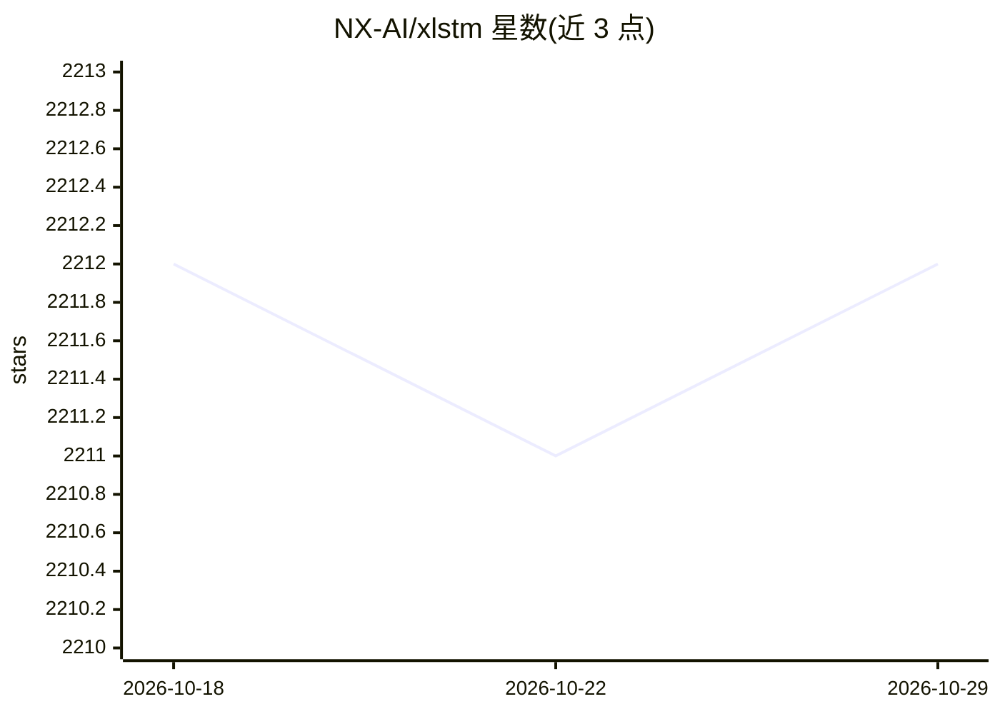

# NX-AI/xlstm

⭐ 2,212 · Python · Apache-2.0 · 推送 2026-10-24 · [GitHub](https://github.com/NX-AI/xlstm) · [官网](https://www.nx-ai.com/) · 组织维护

**面向研究者的 xLSTM 循环神经网络架构 PyTorch 实现库**

NX-AI 官方维护的 xLSTM（Extended LSTM）架构实现：基于指数门控与矩阵记忆的循环神经网络，以 PyTorch 库形式提供 xlstm 模块。包含 NeurIPS 论文中的 xLSTMBlockStack 与 xLSTMLMModel，以及优化的 xLSTM Large 7B 语言模型架构（依赖 mlstm_kernels 快速内核，权重托管在 Hugging Face）。主要在 NVIDIA GPU 上测试，sLSTM CUDA 内核要求 Compute Capability >= 8.0，AMD GPU 可用 Triton 内核，Apple Silicon 建议原生 PyTorch 实现或社区 MLX 移植。附快速上手 notebook 与合成实验脚本。

## 筛选速览

| 维度 | 判定 | 备注 |
|---|---|---|
| AI 角色 | `ai-native` | 本体是模型或模型工具 |
| 许可风险 | `permissive` | Apache-2.0 |
| 部署形态 | `library` | 以包/库形式分发 |
| 模型依赖 | — | README 未给出锁定关系 |
| 硬件要求 | — | 无带数字的原话,不猜 |
| 安装摩擦 | `medium` | 含编译或系统依赖之一 |
| 成熟度 | — | 结构信号不足 |

## 能力要点

- 提供 xLSTMBlockStack（可作替代骨干）与 xLSTMLMModel（语言建模）两类模型组件
- xLSTM Large 7B 循环语言模型架构的独立单文件实现，权重托管于 Hugging Face
- sLSTM 提供 CUDA 内核（要求 Compute Capability >= 8.0），Triton 内核支持 AMD GPU
- 附带 Parity 与 Multi-Query Associative Recall 合成实验脚本

## 适用场景

- 在语言建模或非语言任务中使用 xLSTM 架构训练模型
- 将 xLSTMBlockStack 作为现有项目中的替代骨干集成到其他架构
- 加载并运行 xLSTM 7B 循环语言模型进行推理

## 场景标签

`模型训练` · 领域:训练与推理

## 证据(README 行号)

> L17: xLSTM is a new Recurrent Neural Network architecture based on ideas of the original LSTM.
> L18: Through Exponential Gating with appropriate normalization and stabilization techniques and a new Matrix Memory it o
> L73: We provide a standalone single file implementation of the xLSTM Large architecture in `xlstm/xlstm_large/model.py`.

## 星数曲线

2026-10-18 2,212 → 2026-10-29 2,212（+0）

---
*卡片 v1 · prompt 1.4 · 生成 2026-10-21 · 置信度 high · 依据 README sha `078fa1501613` · [字段定义](../../DATASET.md)*
