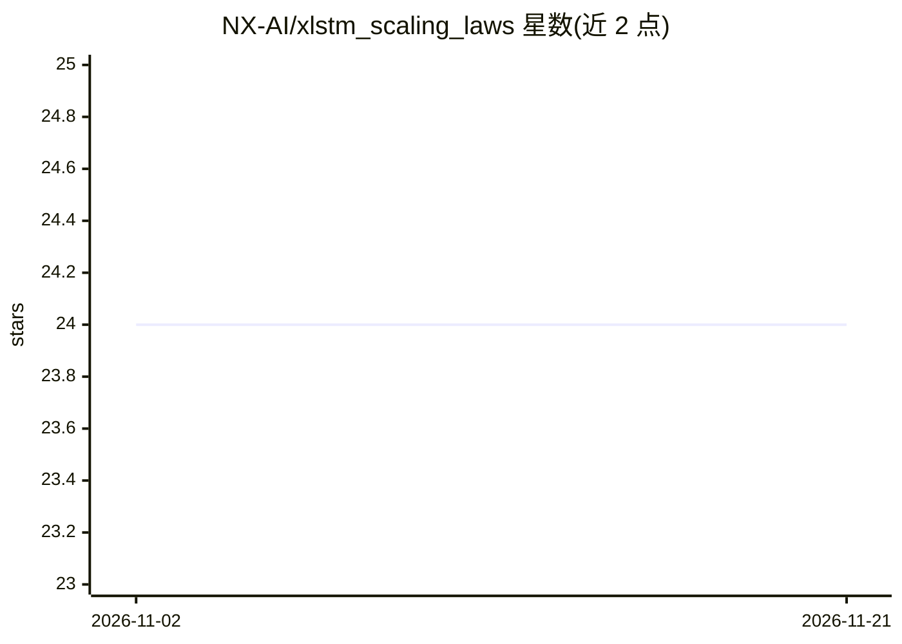

# NX-AI/xlstm_scaling_laws

⭐ 24 · Jupyter Notebook · Apache-2.0 · 推送 2026-11-06 · [GitHub](https://github.com/NX-AI/xlstm_scaling_laws) · 组织维护

**xLSTM 与 Transformer 缩放律研究的代码与数据仓库**

NX-AI 团队发布的研究代码与数据仓库，配套 ICLR 2026 论文：研究 xLSTM 架构与稠密多头 Transformer 在不同模型规模（80M–7B 参数）、训练数据（2B–2T tokens）与上下文长度下的缩放行为与计算特性。提供训练运行数据集（pickle 文件）、参数化 L(N,D) 拟合脚本、复现论文图表与推理时间模型拟合的 Jupyter notebooks，以及通过 pip 安装依赖并用脚本从 HuggingFace checkpoint 运行 xLSTM 推理的流程。

## 筛选速览

| 维度 | 判定 | 备注 |
|---|---|---|
| AI 角色 | `ai-knowledge` | 知识聚合/清单类 |
| 许可风险 | `permissive` | Apache-2.0 |
| 部署形态 | `library` | 以包/库形式分发 |
| 模型依赖 | — | README 未给出锁定关系 |
| 硬件要求 | — | 无带数字的原话,不猜 |
| 安装摩擦 | `low` | 无编译、无系统依赖或容器化 |
| 成熟度 | — | 结构信号不足 |

## 能力要点

- 涵盖 80M–7B 参数、2B–2T tokens 的训练运行数据集
- 提供复现论文全部图表的 Jupyter notebooks
- 脚本运行参数化 L(N,D) 缩放律拟合
- 支持从 HuggingFace checkpoint 运行 xLSTM 模型推理

## 适用场景

- 复现论文中的 xLSTM/Transformer 缩放律分析与图表
- 访问训练运行原始数据做自己的缩放律研究
- 下载并运行缩放律研究的 xLSTM checkpoint 做推理

## 场景标签

`模型训练` · 领域:训练与推理

## 证据(README 行号)

> L13: This repository contains the code and data for our research on xLSTM scaling laws. We investigate the scaling behav
> L61: We provide all experiment logs and run data in several pickle files in the `data/` folder.

## 星数曲线

2026-11-02 24 → 2026-11-21 24（+0）

---
*卡片 v1 · prompt 1.4 · 生成 2026-11-18 · 置信度 mid · 依据 README sha `ef8392816a84` · [字段定义](../../DATASET.md)*
