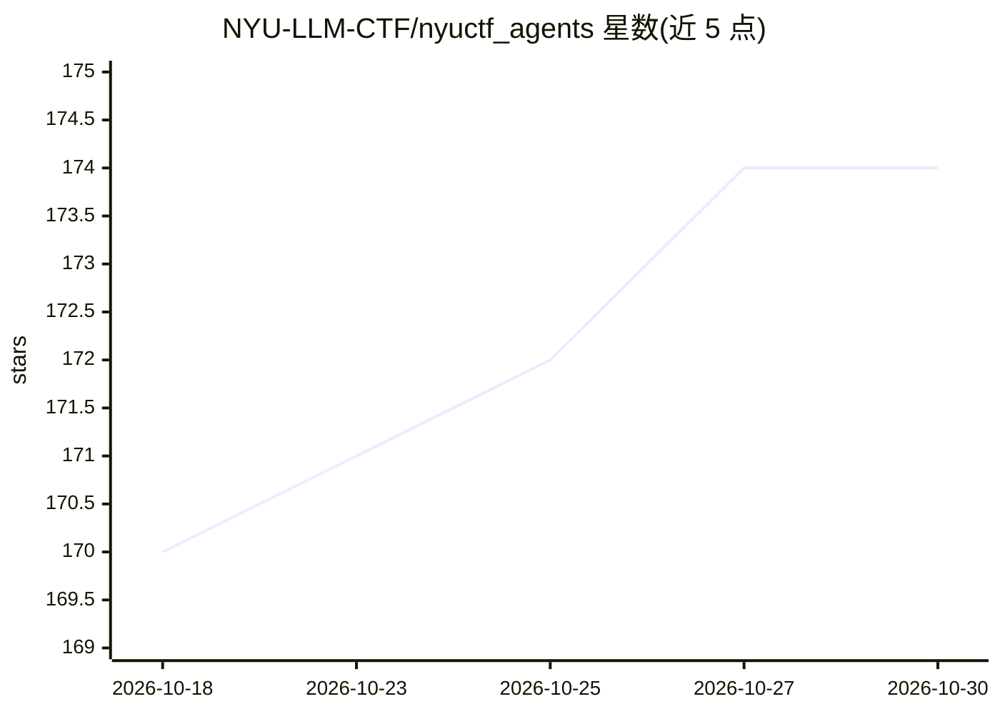

# NYU-LLM-CTF/nyuctf_agents

⭐ 174 · Python · MIT · 推送 2026-07-17 · [GitHub](https://github.com/NYU-LLM-CTF/nyuctf_agents) · [官网](https://nyu-llm-ctf.github.io) · 组织维护

**解 CTF 题目的 LLM 多智能体框架（D-CIPHER 与基线）**

NYU CTF Bench 配套的自动化解题智能体仓库，含 D-CIPHER 多智能体框架（planner、executor、可选 auto-prompter）与 NYU CTF Baseline 单智能体。智能体在 Docker 环境中运行并与 CTF 题目交互解题；D-CIPHER 支持单 executor 消融实验与 --enable-autoprompt 选项。安装需 Docker 与 Python 3.10+，运行 setup 脚本构建镜像并下载数据集，按 challenge 名称逐题运行。

## 筛选速览

| 维度 | 判定 | 备注 |
|---|---|---|
| AI 角色 | `ai-native` | 本体是模型或模型工具 |
| 许可风险 | `permissive` | MIT |
| 部署形态 | `self-host` | docker 或自建部署 |
| 模型依赖 | — | README 未给出锁定关系 |
| 硬件要求 | — | 无带数字的原话,不猜 |
| 安装摩擦 | `low` | 无编译、无系统依赖或容器化 |
| 成熟度 | — | 结构信号不足 |

## 能力要点

- D-CIPHER：planner/executor/auto-prompter 多智能体协作解题
- 在 Docker 环境中与 CTF 题目交互
- 提供单 executor 消融实验与 baseline 运行脚本
- 附带 NYU CTF 数据集下载命令

## 适用场景

- 在 NYU CTF Bench 上运行智能体自动解 CTF 题
- 复现或对比 D-CIPHER 与 baseline 智能体
- 做 planner/auto-prompter 组件的消融实验

## 场景标签

`多智能体` `网络安全` `Agent 框架` · 领域:Agent 开发

## 证据(README 行号)

> L3: This repository holds the LLM agents for solving CTF challenges developed for the NYU CTF Bench.
> L6:  - **D-CIPHER:** The multi-agent framework involving planner, executor, and auto-prompter agent with enhanced intera

## 星数曲线

2026-10-18 170 → 2026-10-30 174（+4）

---
*卡片 v1 · prompt 1.4 · 生成 2026-10-23 · 置信度 high · 依据 README sha `acc359fce78b` · [字段定义](../../DATASET.md)*
