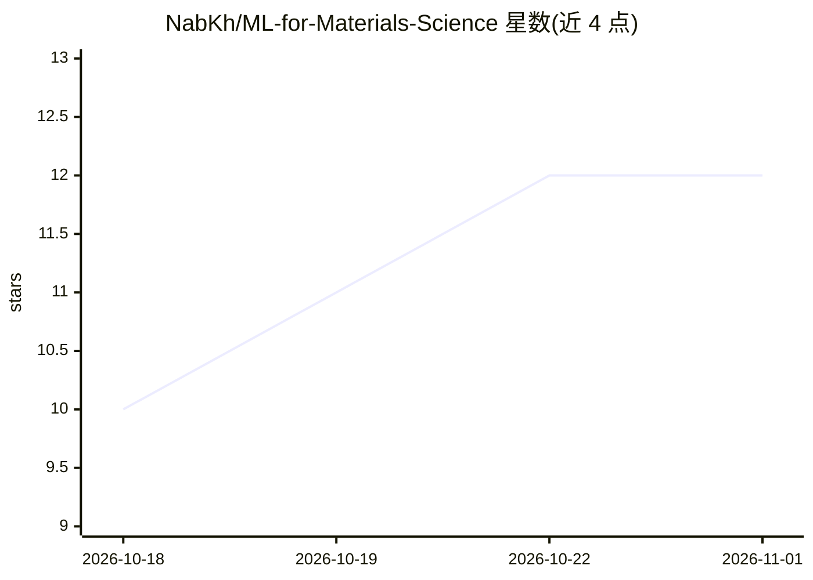

# NabKh/ML-for-Materials-Science

⭐ 12 · Jupyter Notebook · MIT · 推送 2026-10-17 · [GitHub](https://github.com/NabKh/ML-for-Materials-Science) · [官网](https://sustai-nabil.com/teaching/) · 个人维护

**机器学习应用于材料科学的交互式教程系列（Jupyter）**

面向材料科学研究者与学生的 Jupyter Notebook 教程路径：已发布的 Tutorial 07 覆盖 ML 基础、Materials Project 数据获取、matminer 特征化、经典模型、SHAP 可解释性与端到端带隙预测项目；Tutorial 08（神经网络势）与 Tutorial 09（高级特征与发现）已列出大纲但尚未发布。每个 Notebook 带学习目标、时间估计、自测题与习作答案，支持 Colab/Binder 云端运行或本地克隆安装，GPU 支持为可选项，需免费 Materials Project API key。

## 筛选速览

| 维度 | 判定 | 备注 |
|---|---|---|
| AI 角色 | `ai-knowledge` | 知识聚合/清单类 |
| 许可风险 | `permissive` | MIT |
| 部署形态 | `None` |  |
| 模型依赖 | — | README 未给出锁定关系 |
| 硬件要求 | — | 无带数字的原话,不猜 |
| 安装摩擦 | `medium` | 含编译或系统依赖之一 |
| 成熟度 | — | 结构信号不足 |

## 能力要点

- Tutorial 07 含 7 个 Notebook：从 ML 基础到带隙预测端到端项目
- 每个 Notebook 配学习目标、时间估计、自测题与习作答案
- 使用 matminer/pymatgen/shap/dscribe/matgl 等库与 Materials Project 等数据库
- 全部 Notebook 支持 Open in Colab，01–03 另有 Binder 徽章

## 适用场景

- 系统学习如何将机器学习应用于材料发现与性质预测
- 在 Colab 上免安装跟做材料信息学教程
- 教学中用作带练习和答案的课程材料

## 场景标签

`教程课程` · 领域:学习与行业

## 证据(README 行号)

> L3: A comprehensive, interactive learning path for applying machine learning to materials discovery, property prediction
> L47: ### Tutorial 07: ML for Materials Discovery

## 星数曲线

2026-10-18 10 → 2026-11-01 12（+2）

---
*卡片 v1 · prompt 1.4 · 生成 2026-11-01 · 置信度 high · 依据 README sha `96fe0f437df1` · [字段定义](../../DATASET.md)*
