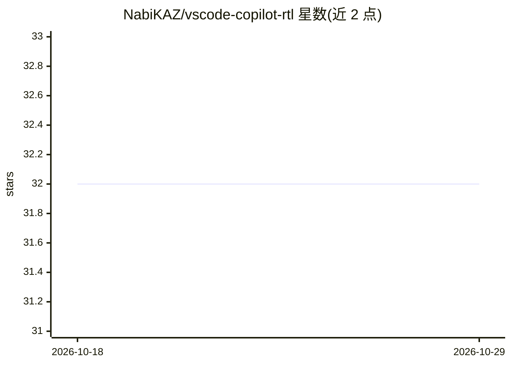

# NabiKAZ/vscode-copilot-rtl

⭐ 32 · JavaScript · GPL-3.0 · 推送 2026-08-23 · [GitHub](https://github.com/NabiKAZ/vscode-copilot-rtl) · 个人维护

**为 VS Code Copilot Chat 面板添加 RTL（右到左）文字支持的扩展**

一个 VS Code 扩展，通过打补丁方式为 GitHub Copilot Chat 面板添加从右到左（RTL）排版支持，面向波斯语等 RTL 语言用户。功能包括按段落自动检测 RTL/LTR 方向、强制整体方向切换、自定义字体/字号/行距，代码块保持 LTR。内置 Vazirmatn 字体作为回退，检测波斯语、阿拉伯语、希伯来语等文字。多数设置实时生效无需重载；VS Code 更新可能还原补丁，扩展会提示重新应用。卸载前需先运行 Disable 命令；另提供免安装的手动脚本方式。GPL-3.0 许可。

## 筛选速览

| 维度 | 判定 | 备注 |
|---|---|---|
| AI 角色 | `ai-enhanced` | 去掉 AI 部分产品仍成立 |
| 许可风险 | `viral` | GPL-3.0 |
| 部署形态 | `None` |  |
| 模型依赖 | — | README 未给出锁定关系 |
| 硬件要求 | — | 无带数字的原话,不猜 |
| 安装摩擦 | `low` | 无编译、无系统依赖或容器化 |
| 成熟度 | — | 结构信号不足 |

## 能力要点

- 按段落自动检测 RTL/LTR 方向，混排波斯语/英语对话可正确显示
- Ctrl+Alt+R 循环切换 auto→RTL→LTR，实时生效无需重载
- 内置 Vazirmatn 字体作为回退，可自定义字体/字号/行距
- 代码块与结果编辑器保持 LTR 方向；VS Code 更新还原补丁时给出提示

## 适用场景

- 用波斯语等 RTL 语言与 Copilot Chat 对话时获得正确排版
- 调整 Copilot Chat 面板的波斯语字体与行距
- 混排波斯语与英文内容时自动按段判定文字方向

## 场景标签

 · 领域:开发者工具/文字排版本地化

## 证据(README 行号)

> L3: A Visual Studio Code extension that adds **Right-to-Left (RTL)** support to the GitHub Copilot Chat panel — optimize
> L12: - Preserves LTR direction for code blocks

## 星数曲线

2026-10-18 32 → 2026-10-29 32（+0）

---
*卡片 v1 · prompt 1.4 · 生成 2026-10-26 · 置信度 high · 依据 README sha `9891b319efd0` · [字段定义](../../DATASET.md)*
