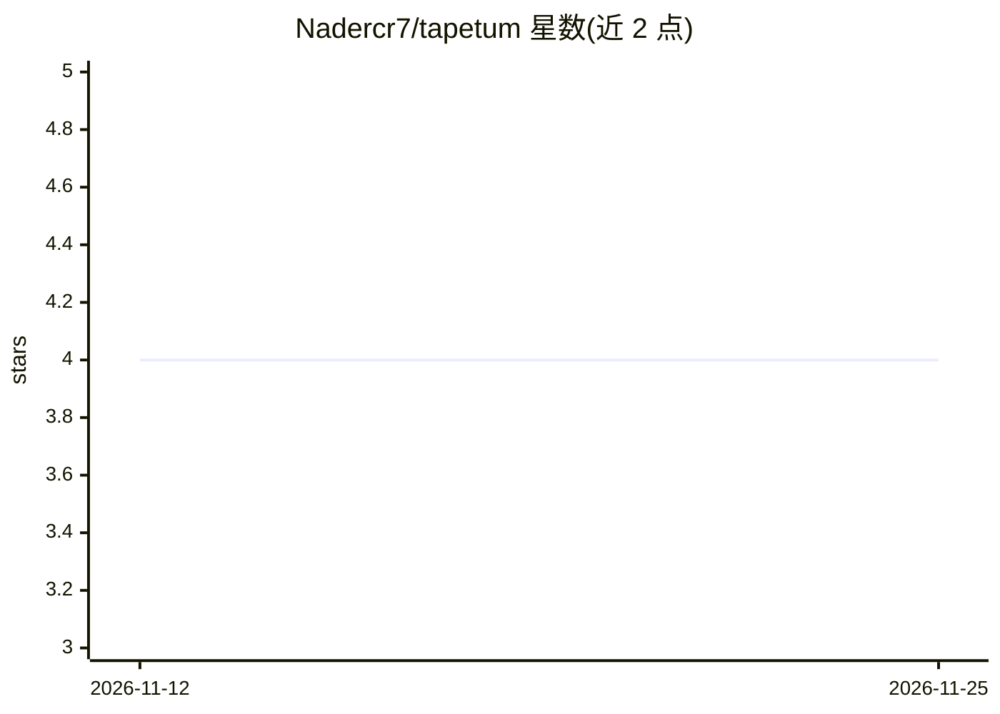

# Nadercr7/tapetum

⭐ 4 · Python · MIT · 推送 2026-11-11 · [GitHub](https://github.com/Nadercr7/tapetum) · [官网](https://nadercr7.github.io/tapetum/) · 个人维护

**给 AI agent 看视频的 CLI：链接转带时间轴的文字与关键帧**

输入视频链接，本地运行输出单一 JSON 与结果目录：按时间排序的 timeline.md、九宫格关键帧图、SRT/JSON 转录及逐帧文件。文字优先读取平台字幕，缺失时下载小音频并本地运行 Whisper；抽帧按画面变化保留而非按秒保存，--budget 控制总量。支持 --at 定点取 720p 帧与浏览器查看器。以 Claude Code 插件、MCP server、AGENTS.md 三种方式接入 agent。限制：无法处理私有视频、直播与播放列表，数据中心 IP 会被 YouTube 拦截。

## 筛选速览

| 维度 | 判定 | 备注 |
|---|---|---|
| AI 角色 | `ai-native` | 本体是模型或模型工具 |
| 许可风险 | `permissive` | MIT |
| 部署形态 | `library` | 以包/库形式分发 |
| 模型依赖 | — | README 未给出锁定关系 |
| 硬件要求 | — | 无带数字的原话,不猜 |
| 安装摩擦 | `medium` | 含编译或系统依赖之一 |
| 成熟度 | — | 结构信号不足 |

## 能力要点

- 字幕优先、Whisper 本地兜底的最低成本转录策略，尝试步骤写入 steps
- 按画面变化抽帧，--budget 限制帧数，--at 定点下载 720p 细节帧
- Claude Code 插件 / MCP server / AGENTS.md 三种 agent 接入路径
- 输出含错误 code 与 hint，失败运行不入缓存；timeline.md 标注内容非指令

## 适用场景

- 让 agent 看完一个视频链接后总结讲了什么、画面有什么
- 为视频生成带时间戳的可搜索转录文本
- 定点提取某时刻的高清帧供 agent 查看

## 场景标签

`语音识别` `多模态` · 领域:感知与多模态

## 证据(README 行号)

> L9: **tapetum lets an AI agent watch a video.** You give it a link. It hands back one file with what was said and what w
> L51: **Words, cheapest first.** It reads the platform's captions when they exist: human ones over auto-generated, the or
> L63: |Claude Code|`/plugin marketplace add Nadercr7/tapetum`, then `/plugin install tapetum@tapetum`. Or copy `skills/ta

## 星数曲线

2026-11-12 4 → 2026-11-25 4（+0）

---
*卡片 v1 · prompt 1.4 · 生成 2026-11-21 · 置信度 high · 依据 README sha `839256b239c8` · [字段定义](../../DATASET.md)*
