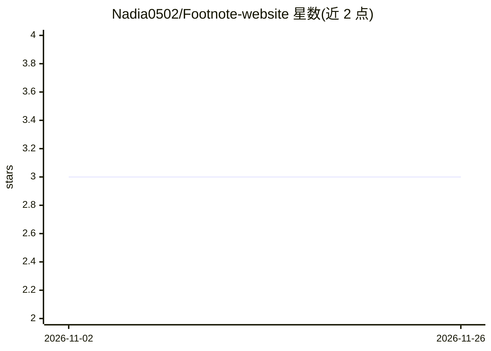

# Nadia0502/Footnote-website

⭐ 3 · TypeScript · 推送 2026-11-01 · [GitHub](https://github.com/Nadia0502/Footnote-website) · [官网](https://footnote-ecru.vercel.app/) · 个人维护

**面向分析师的 AI 辅助财报工作台：从 10-K 计算经济利润**

Footnote 读取 SEC EDGAR 上的 10-K 及其 XBRL 数据，从 MD&A、现金流量表和附注中提出异常项目，将报告利润转换为 NOPAT、投入资本、ROIC 与 WACC 对比、经济利润及规则化评级。工作流分 7 步，每步设分析师确认点：AI 提出建议、确定性代码计算、人工验证，语言模型不产出最终数字。每项携带文件、章节、页码与原文引用，无法核实的引用标记 unverified；所有决策记录于 append-only 日志。为原型，仅适用于美国经营性公司 10-K，仅供教育用途。

## 筛选速览

| 维度 | 判定 | 备注 |
|---|---|---|
| AI 角色 | `ai-enhanced` | 去掉 AI 部分产品仍成立 |
| 许可风险 | `none` | — |
| 部署形态 | `library` | 以包/库形式分发 |
| 模型依赖 | — | README 未给出锁定关系 |
| 硬件要求 | — | 无带数字的原话,不猜 |
| 安装摩擦 | `low` | 无编译、无系统依赖或容器化 |
| 成熟度 | — | 结构信号不足 |

## 能力要点

- AI 提议、确定性代码计算、分析师验证的三方分工流程
- 每个数字带文件/章节/页码/原文引用，不可核实引用标记 unverified
- append-only 验证日志记录每次提议与决策
- 内置评估：AI 提议与人工核对的参考集对比，prompt 版本记录结果

## 适用场景

- 把 10-K 的报告利润逐项调整为经济利润并追溯出处
- 在 AI 提取与分类附注异常项目时保留人工把关
- 按行业同业对比计算 ROIC 并生成规则化评级报告

## 场景标签

`金融量化` `数据分析` · 领域:效率与自动化

## 证据(README 行号)

> L13: Footnote combines the two. **The AI reads and proposes, deterministic code calculates, and the analyst validates.**
> L43: |Language models|Qwen through Scaleway Generative APIs (primary), Google Gemini Flash (fallback); structured JSON o

## 星数曲线

2026-11-02 3 → 2026-11-26 3（+0）

---
*卡片 v1 · prompt 1.4 · 生成 2026-11-22 · 置信度 high · 依据 README sha `e840c78ca754` · [字段定义](../../DATASET.md)*
