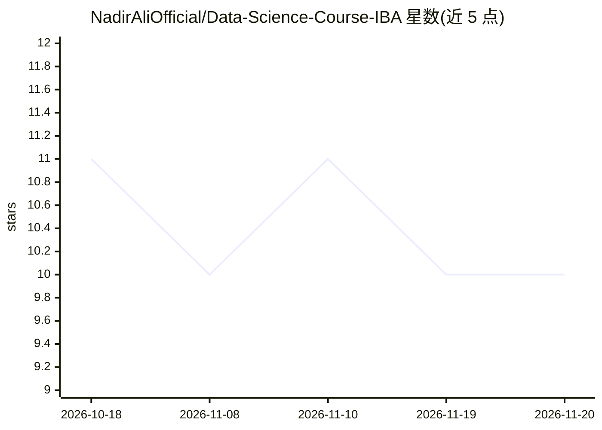

# NadirAliOfficial/Data-Science-Course-IBA

⭐ 10 · Jupyter Notebook · MIT · 推送 2026-11-03 · [GitHub](https://github.com/NadirAliOfficial/Data-Science-Course-IBA) · 组织维护

**IBA 数据科学课程的讲义、作业与项目资料集**

IBA 数据科学课程的教学材料仓库，包含课程讲义 Jupyter notebook、实验作业与多个 Python 项目脚本，主题覆盖 Pandas 数据整理、Matplotlib/Seaborn 可视化与 scikit-learn 机器学习。附带两个可运行示例：基于 Yahoo Finance 数据与 Random Forest 回归的股价预测 Streamlit 应用，以及 TF-IDF + Logistic Regression 的心理健康文本情感分类应用。依赖通过 pip 安装，许可证为 MIT 且声明仅限学术用途。

## 筛选速览

| 维度 | 判定 | 备注 |
|---|---|---|
| AI 角色 | `ai-knowledge` | 知识聚合/清单类 |
| 许可风险 | `permissive` | MIT |
| 部署形态 | `library` | 以包/库形式分发 |
| 模型依赖 | — | README 未给出锁定关系 |
| 硬件要求 | — | 无带数字的原话,不猜 |
| 安装摩擦 | `low` | 无编译、无系统依赖或容器化 |
| 成熟度 | — | 结构信号不足 |

## 能力要点

- 包含讲义 notebook、实验作业与课程项目的完整资料
- 股价预测示例：Yahoo Finance 数据 + 随机森林回归 + Streamlit UI
- 心理健康文本情感分类示例：TF-IDF + Logistic Regression
- 提供 SMA/RSI 技术指标计算与时间序列建模准备脚本

## 适用场景

- 学习 Python 数据整理、可视化与机器学习入门课程内容
- 参考课程项目了解 Streamlit 应用的构建方式
- 作为教学场景复用讲义与实验作业材料

## 场景标签

`教程课程` · 领域:学习与行业

## 证据(README 行号)

> L3: Course material for the Data Science course at IBA — lectures, assignments, and projects using Python.
> L21: This repository contains the teaching materials and practical projects for the Data Science course at IBA. It inclu

## 星数曲线

2026-10-18 11 → 2026-11-20 10（-1）

---
*卡片 v1 · prompt 1.4 · 生成 2026-11-20 · 置信度 high · 依据 README sha `5478669c61be` · [字段定义](../../DATASET.md)*
