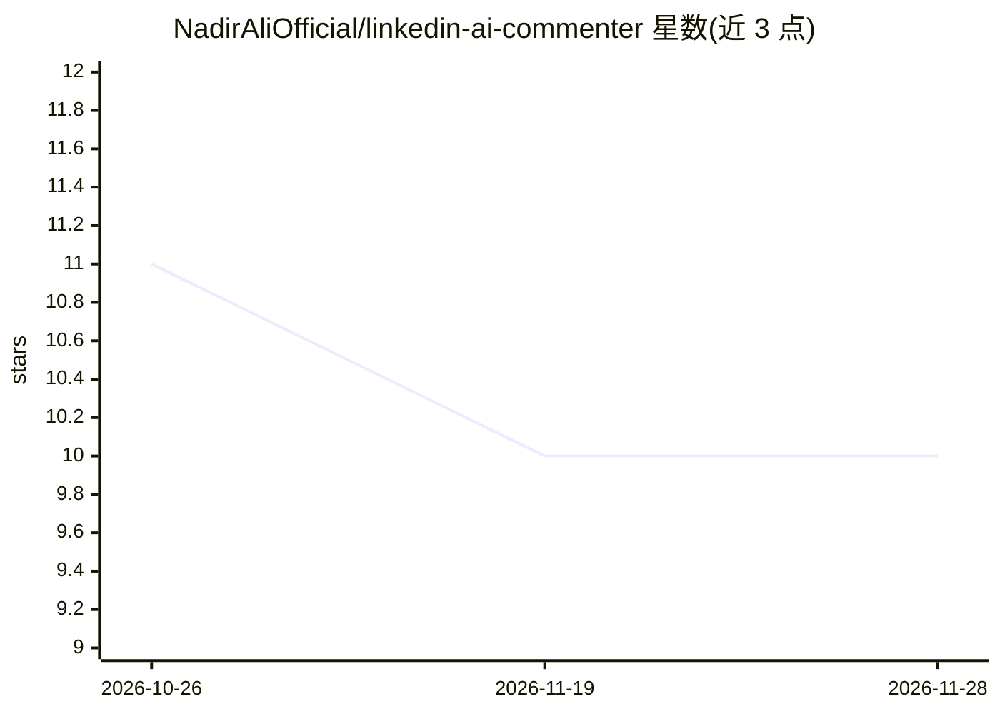

# NadirAliOfficial/linkedin-ai-commenter

⭐ 10 · JavaScript · MIT · 推送 2026-11-15 · [GitHub](https://github.com/NadirAliOfficial/linkedin-ai-commenter) · 组织维护

**Chrome 扩展：为 LinkedIn 帖子生成草稿评论**

一个 Chrome 扩展：读取当前 LinkedIn 帖子的可见文本，发送到 Groq API 生成一条简短评论草稿并插入评论框，用户自行审阅后发布。流程启动时还会给未互动的帖子点赞并尝试标记作者。API key 保存在 Chrome 扩展本地存储，本地记录近期生成日志。README 提示草稿可能不准确，需逐条检查。安装方式是在 Chrome 中以未打包扩展加载本目录。

## 筛选速览

| 维度 | 判定 | 备注 |
|---|---|---|
| AI 角色 | `ai-native` | 本体是模型或模型工具 |
| 许可风险 | `permissive` | MIT |
| 部署形态 | `None` |  |
| 模型依赖 | locked-api |  |
| 硬件要求 | — | 无带数字的原话,不猜 |
| 安装摩擦 | `low` | 无编译、无系统依赖或容器化 |
| 成熟度 | — | 结构信号不足 |

## 能力要点

- 读取帖子文本并调用 Groq API 生成评论草稿
- 草稿插入评论框，由用户审阅后手动发布
- API key 存储于 Chrome 扩展本地存储，本地保留生成日志
- 点赞未互动帖子并尝试标记作者

## 适用场景

- 在 LinkedIn 上快速起草对帖子的评论
- 保持互动节奏的同时人工把关发布内容

## 场景标签

`AI 写作` · 领域:内容生成

## 证据(README 行号)

> L3: A Chrome extension that drafts short comments from LinkedIn post text using the Groq API. It inserts a draft into th
> L9: 3. Refresh LinkedIn and click a post’s Comment button. The post text is sent to Groq to generate a draft. The extens

## 星数曲线

2026-10-26 11 → 2026-11-28 10（-1）

---
*卡片 v1 · prompt 1.4 · 生成 2026-11-20 · 置信度 high · 依据 README sha `02b2ce93befd` · [字段定义](../../DATASET.md)*
