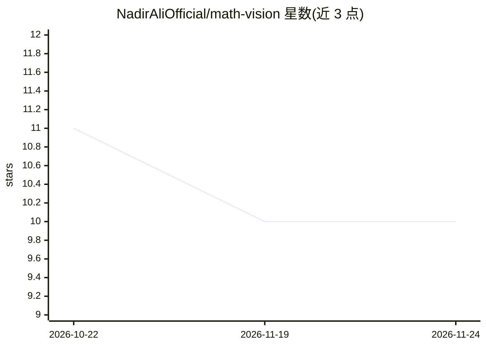

# NadirAliOfficial/math-vision

⭐ 10 · Python · MIT · 推送 2026-11-08 · [GitHub](https://github.com/NadirAliOfficial/math-vision) · 个人维护

**用手指在空中写算式并实时求解的摄像头应用**

基于 Python 的桌面工具：通过摄像头与 MediaPipe Hands 追踪手指与手势——食指悬停移动、捏合在屏幕上书写算式、张开手掌擦除；在算式末尾写 `=` 后调用 LLM 识别并求解，答案以手写样式显示在表达式旁。求解默认走 Groq API（LLaMA 4 Scout），未配置或不可用时自动回退到本地 Ollama（llava-phi3）实现离线运行。支持四则运算、平方、开方等表达式。需要 Python 3.10+ 与摄像头，从源码克隆并以 pip 安装依赖运行。

## 筛选速览

| 维度 | 判定 | 备注 |
|---|---|---|
| AI 角色 | `ai-native` | 本体是模型或模型工具 |
| 许可风险 | `permissive` | MIT |
| 部署形态 | `library` | 以包/库形式分发 |
| 模型依赖 | local-ok | 支持本地模型 |
| 硬件要求 | — | 无带数字的原话,不猜 |
| 安装摩擦 | `low` | 无编译、无系统依赖或容器化 |
| 成熟度 | — | 结构信号不足 |

## 能力要点

- 手势控制书写/擦除/求解：食指移动、捏合书写、手掌擦除
- Groq（LLaMA 4 Scout）云端求解，Ollama llava-phi3 本地回退，可完全离线
- MediaPipe Hands 实时手指追踪 + OpenCV 摄像头与画布

## 适用场景

- 对空气手写 `2 + 2`、`√16` 等算式并即时看到答案
- 无 API key 环境下用 Ollama 离线演示手势数学求解
- 体验摄像头手势识别与本地 LLM 组合的开发试验

## 场景标签

 · 领域:计算机视觉/交互工具

## 证据(README 行号)

> L3: Draw math expressions in the air with your index finger. Write `=` and the answer appears instantly — powered by Gro
> L53: The app automatically falls back to Ollama if Groq is unavailable.
> L57: - **MediaPipe Hands** — real-time finger + gesture tracking

## 星数曲线

2026-10-22 11 → 2026-11-24 10（-1）

---
*卡片 v1 · prompt 1.4 · 生成 2026-11-20 · 置信度 high · 依据 README sha `09a2ebe4d6a0` · [字段定义](../../DATASET.md)*
