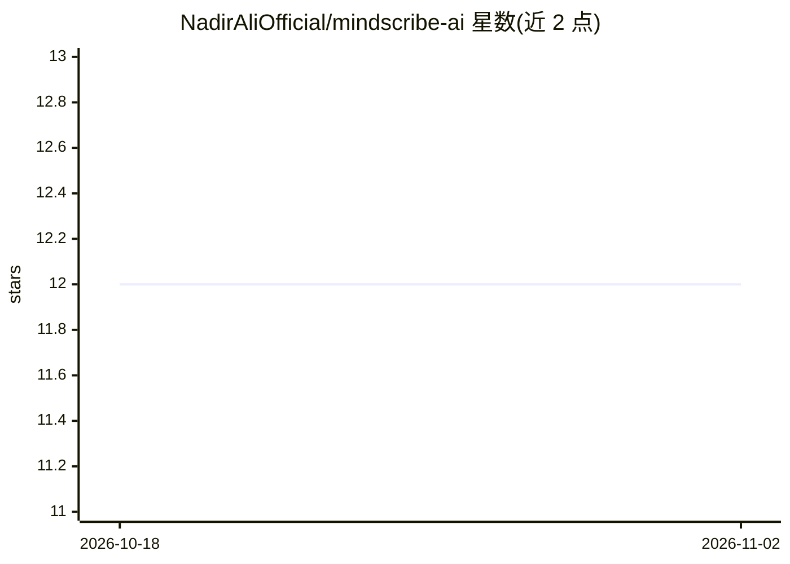

# NadirAliOfficial/mindscribe-ai

⭐ 12 · JavaScript · MIT · 推送 2026-10-20 · [GitHub](https://github.com/NadirAliOfficial/mindscribe-ai) · 组织维护

**网页文本框的 AI 智能回复与文本增强 Chrome 扩展**

面向普通用户与自由职业者的浏览器扩展：在 Fiverr、LinkedIn、WhatsApp、Telegram、Discord 等聊天页面读取会话上下文，一键生成适配语气与长度的回复；在任意网站选中文本可进行改进、改写、校对、语气调整与翻译回复，并支持输入时的智能补全。由 Groq AI 提供推理（默认 GPT-OSS 120B，可选 20B），需用户粘贴自己的 Groq API key（最多 3 个、限速自动轮换）。以源码方式通过 Chrome 开发者模式加载安装。

## 筛选速览

| 维度 | 判定 | 备注 |
|---|---|---|
| AI 角色 | `ai-native` | 本体是模型或模型工具 |
| 许可风险 | `permissive` | MIT |
| 部署形态 | `None` |  |
| 模型依赖 | locked-api |  |
| 硬件要求 | — | 无带数字的原话,不猜 |
| 安装摩擦 | `low` | 无编译、无系统依赖或容器化 |
| 成熟度 | — | 结构信号不足 |

## 能力要点

- 覆盖 8+ 聊天平台的一键智能回复，语气与长度随平台和上下文自适应
- 任意网站选中文本即可改写/校对/语气调整/翻译并回复
- 支持最多 3 个 Groq API key，限速时自动轮换
- 可在 GPT-OSS 120B 与 20B 之间切换模型

## 适用场景

- 在 Fiverr/LinkedIn 等平台快速回复客户消息
- 在任意网页改写或校对文字、调整语气
- 跨语言对话中按对方语言直接回复

## 场景标签

`AI 写作` `AI 助手` · 领域:对话与助手

## 证据(README 行号)

> L3: AI-powered Chrome extension for smart replies and text enhancement — works across Fiverr, LinkedIn, WhatsApp, Telegr
> L38: 4. Open the extension popup and paste your Groq API key (free)

## 星数曲线

2026-10-18 12 → 2026-11-02 12（+0）

---
*卡片 v1 · prompt 1.4 · 生成 2026-11-01 · 置信度 high · 依据 README sha `1e8a9fdf4c5c` · [字段定义](../../DATASET.md)*
