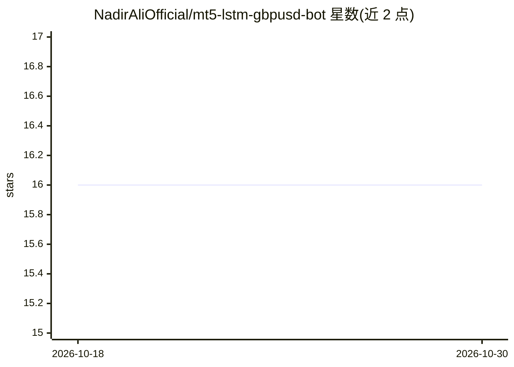

# NadirAliOfficial/mt5-lstm-gbpusd-bot

⭐ 16 · Python · MIT · 推送 2026-09-21 · [GitHub](https://github.com/NadirAliOfficial/mt5-lstm-gbpusd-bot) · 个人维护

**面向 GBPUSD 的 MT5 自动交易框架：LSTM 预测叠加蜡烛图信号**

基于 Python 与 TensorFlow 的 MetaTrader 5 交易自动化框架，专用于 GBPUSD 品种。从 MT5 终端经官方 Python API 读取实时数据，用工程特征（吞没形态、成交量倍数、枢轴位）训练 LSTM 网络生成预测分数，结合成交量和枢轴信号构成入场条件；执行层提供移动止损、1:1 部分止盈、最大回撤限制与实时订单管理，并带回测引擎与权益曲线绘制。要求本机安装并登录 MT5 终端、启用 DLL 导入与自动交易。代码按三个里程碑脚本组织。

## 筛选速览

| 维度 | 判定 | 备注 |
|---|---|---|
| AI 角色 | `ai-native` | 本体是模型或模型工具 |
| 许可风险 | `permissive` | MIT |
| 部署形态 | `library` | 以包/库形式分发 |
| 模型依赖 | — | README 未给出锁定关系 |
| 硬件要求 | — | 无带数字的原话,不猜 |
| 安装摩擦 | `low` | 无编译、无系统依赖或容器化 |
| 成熟度 | — | 结构信号不足 |

## 能力要点

- LSTM 基于工程特征（吞没形态/成交量/枢轴位）训练而非原始 OHLCV
- 同一信号逻辑的回测引擎，LIVE_TRADING 开关切换回测/实盘
- 移动止损、1:1 部分止盈、最大回撤限制的风控执行
- MetaTrader 5 官方 Python API 实时数据接入与订单管理

## 适用场景

- 我在 GBPUSD 上跑带 LSTM 过滤的算法交易策略
- 先回测验证策略再切换实盘执行
- 用移动止损和部分止盈管理持仓风险

## 场景标签

`金融量化` · 领域:学习与行业

## 证据(README 行号)

> L8: A complete trading automation framework combining MetaTrader 5 live data, LSTM neural network predictions, and a ful
> L22: - **LSTM neural network** trained on engineered features — not raw OHLCV

## 星数曲线

2026-10-18 16 → 2026-10-30 16（+0）

---
*卡片 v1 · prompt 1.4 · 生成 2026-10-30 · 置信度 high · 依据 README sha `caafb100e37e` · [字段定义](../../DATASET.md)*
