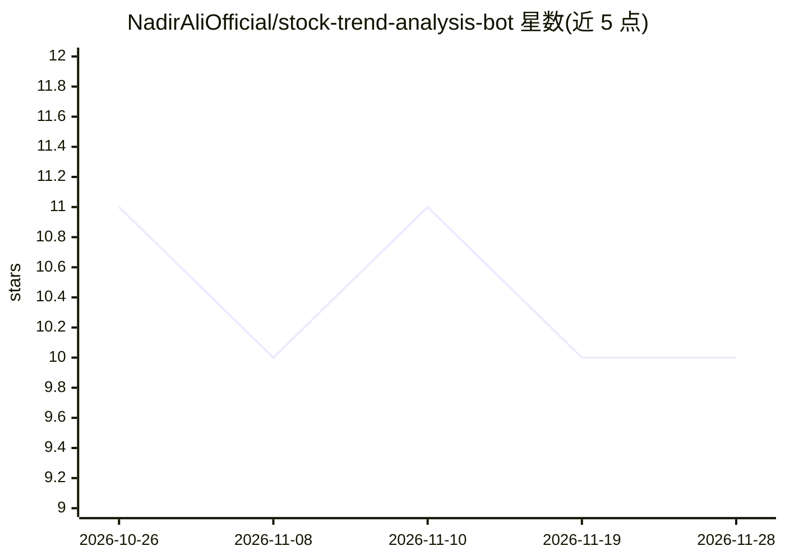

# NadirAliOfficial/stock-trend-analysis-bot

⭐ 10 · Python · MIT · 推送 2026-11-21 · [GitHub](https://github.com/NadirAliOfficial/stock-trend-analysis-bot) · 个人维护

**面向 IBKR 账户的股票趋势分析与交易机器人**

面向 Interactive Brokers 用户的自动化股票分析交易机器人：从 CSV 读入股票列表，通过 IBKR API 获取 6 个时间框架的历史数据，用 EMA 交叉与 RSI 过滤做多周期动量打分，对候选股运行 Prophet 机器学习预测下一交易日价格目标，并对高分股票下达带止损/止盈的 bracket 订单，结果写入 CSV。运行需本机启动 TWS 或 IB Gateway（端口 7497），声明不含期货与期权以符合 Halal 合规要求。

## 筛选速览

| 维度 | 判定 | 备注 |
|---|---|---|
| AI 角色 | `ai-native` | 本体是模型或模型工具 |
| 许可风险 | `permissive` | MIT |
| 部署形态 | `library` | 以包/库形式分发 |
| 模型依赖 | — | README 未给出锁定关系 |
| 硬件要求 | — | 无带数字的原话,不猜 |
| 安装摩擦 | `low` | 无编译、无系统依赖或容器化 |
| 成熟度 | — | 结构信号不足 |

## 能力要点

- EMA 交叉 + RSI 过滤的多时间框架动量打分（6 个时间框架）
- Prophet 模型预测下一交易日价格目标
- 经 IBKR API 下达带止损/止盈的实时 bracket 订单
- CSV 动态加载股票列表并输出结果 CSV

## 适用场景

- 对自有 IBKR 账户自动执行带风控的趋势交易策略
- 批量筛选股票并生成机器学习价格预测
- 基于 CSV 股票清单运行自动化动量评分

## 场景标签

`金融量化` · 领域:学习与行业

## 证据(README 行号)

> L3: An automated stock analysis and trading bot for Interactive Brokers that combines multi-timeframe momentum scoring, 
> L13: 4. Runs Prophet ML forecast on top candidates

## 星数曲线

2026-10-26 11 → 2026-11-28 10（-1）

---
*卡片 v1 · prompt 1.4 · 生成 2026-11-20 · 置信度 high · 依据 README sha `eb3fb1985fd2` · [字段定义](../../DATASET.md)*
