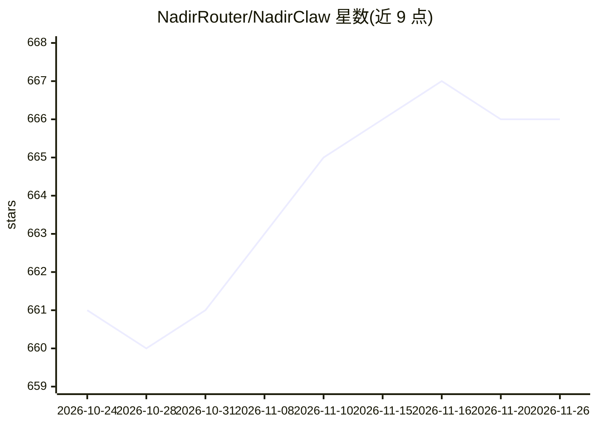

# NadirRouter/NadirClaw

⭐ 666 · Python · NOASSERTION · 推送 2026-11-20 · [GitHub](https://github.com/NadirRouter/NadirClaw) · [官网](https://getnadir.com) · 组织维护

**自托管 LLM 路由代理：把简单提示路由到低价模型以降低成本**

以 OpenAI/Anthropic 兼容代理形式运行的 LLM 路由器，面向使用 Claude Code、Cursor、Codex 等 OpenAI 兼容客户端的个人开发者与自托管用户。工作流为三步：约 10ms 嵌入分类器预测最小可用模型并先路由到低价模型；规则启发式验证器对回答评分（拒绝/截断/JSON 失败）；低于阈值 τ=0.80 时自动升级到更强模型。支持三级/N 级 YAML 配置、回退链、会话固定、上下文压缩与成本追踪（CLI），本地运行、API key 不出本机。PolyForm Noncommercial 许可，非商用免费。

## 筛选速览

| 维度 | 判定 | 备注 |
|---|---|---|
| AI 角色 | `ai-ecosystem` | LLM/agent 周边工具 |
| 许可风险 | `none` | NOASSERTION |
| 部署形态 | `self-host` | docker 或自建部署 |
| 模型依赖 | local-ok | 支持本地模型 |
| 硬件要求 | — | 无带数字的原话,不猜 |
| 安装摩擦 | `low` | 无编译、无系统依赖或容器化 |
| 成熟度 | — | 结构信号不足 |

## 能力要点

- Route-Verify-Escalate 级联：低价模型先行，评分不足自动升级
- OpenAI 兼容（/v1/chat/completions）与 Anthropic 兼容（/v1/messages）双端点，drop-in 代理
- 可插拔分类器（binary centroid / DistilBERT / Laya）与 N 级 YAML 热重载配置
- 回退链、流式 SSE、上下文压缩与成本追踪（nadirclaw savings CLI）

## 适用场景

- 让 Claude Code/Codex/Cursor 的请求自动分流到更便宜的模型以降低 API 开销
- 自托管代理场景下让 API key 不离开本机
- 为不同复杂度的提示配置多级模型路由与预算控制

## 场景标签

`模型网关` · 领域:Agent 开发

## 证据(README 行号)

> L8:  NadirClaw routes every prompt to the cheapest model that can reliably answer, verifies the
> L182: - **OpenAI-compatible API** — drop-in replacement for any tool that speaks the OpenAI chat completions API (`/v1/c

## 星数曲线

2026-10-24 661 → 2026-11-26 666（+5）

---
*卡片 v1 · prompt 1.4 · 生成 2026-11-24 · 置信度 mid · 依据 README sha `394f20cff52c` · [字段定义](../../DATASET.md)*
