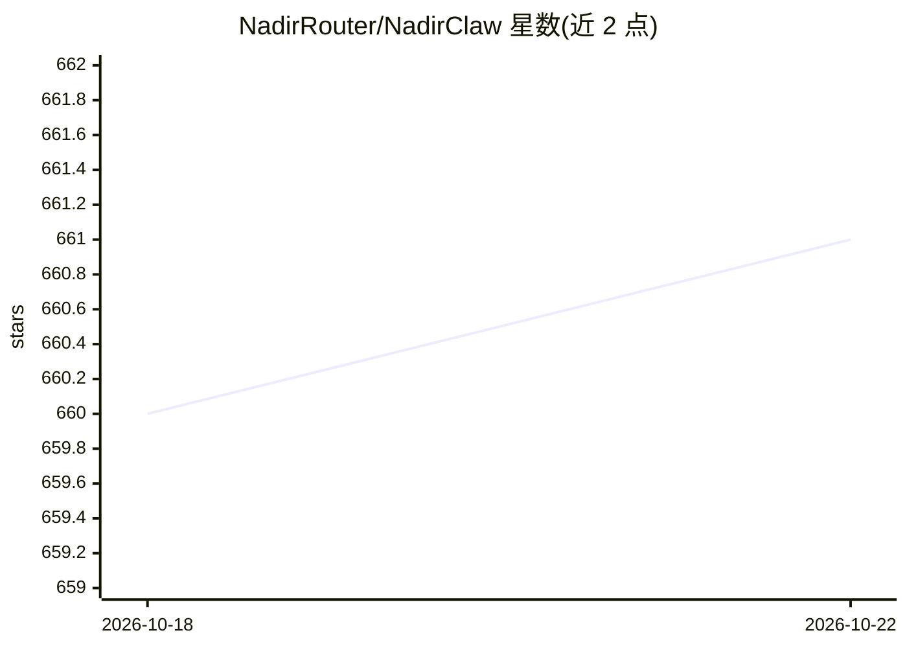

# NadirRouter/NadirClaw

⭐ 661 · Python · NOASSERTION · 推送 2026-10-21 · [GitHub](https://github.com/NadirRouter/NadirClaw) · [官网](https://getnadir.com) · 组织维护

**自托管 LLM 路由代理：按提示复杂度路由到不同价位模型并验证升级**

本地运行的 OpenAI/Anthropic 兼容代理：约 10ms 的嵌入分类器将每个提示分派到简单/中等/复杂三档模型，先用便宜模型生成，再用规则启发式校验器（拒绝/截断/JSON 失败检查，阈值 τ=0.80）打分，不达标自动升级到更强模型。面向使用 Claude Code、Cursor、Codex 等工具并希望降低 API 成本的开发者。支持 Gemini/OpenAI/Anthropic/Ollama 及 LiteLLM 兼容后端，提供费用追踪、回退链、流式传输。许可证为 PolyForm Noncommercial（非商用免费，商业需另行授权），另有托管版 Nadir Pro。

## 筛选速览

| 维度 | 判定 | 备注 |
|---|---|---|
| AI 角色 | `ai-ecosystem` | LLM/agent 周边工具 |
| 许可风险 | `none` | NOASSERTION |
| 部署形态 | `self-host` | docker 或自建部署 |
| 模型依赖 | local-ok | 支持本地模型 |
| 硬件要求 | — | 无带数字的原话,不猜 |
| 安装摩擦 | `low` | 无编译、无系统依赖或容器化 |
| 成熟度 | — | 结构信号不足 |

## 能力要点

- 约 10ms 嵌入分类器做三层/N 层模型路由，YAML 配置热加载
- 验证器门控级联：启发式校验未过阈值 τ=0.80 时自动升级模型
- OpenAI 兼容 /v1/chat/completions 与 Anthropic 兼容 /v1/messages 双端点
- 每请求成本对比、按模型/日期费用报表、CSV/JSONL 导出

## 适用场景

- 让 Claude Code / Cursor / Codex 等工具自动走便宜模型、按需升级以降成本
- 本地代理统一管理多家模型提供商的 API key
- 追踪各模型与各时段的 API 花费并做预算告警

## 场景标签

`模型网关` · 领域:Agent 开发

## 证据(README 行号)

> L39: - **Drop-in proxy** — works with any OpenAI-compatible tool
> L182: - **OpenAI-compatible API** — drop-in replacement for any tool that speaks the OpenAI chat completions API (`/v1/c
> L52: 1. **Route** — a ~10ms embedding classifier predicts the *smallest* model likely to answer and sends the prompt the

## 星数曲线

2026-10-18 660 → 2026-10-22 661（+1）

---
*卡片 v1 · prompt 1.4 · 生成 2026-10-21 · 置信度 mid · 依据 README sha `e4741b6ecfc2` · [字段定义](../../DATASET.md)*
