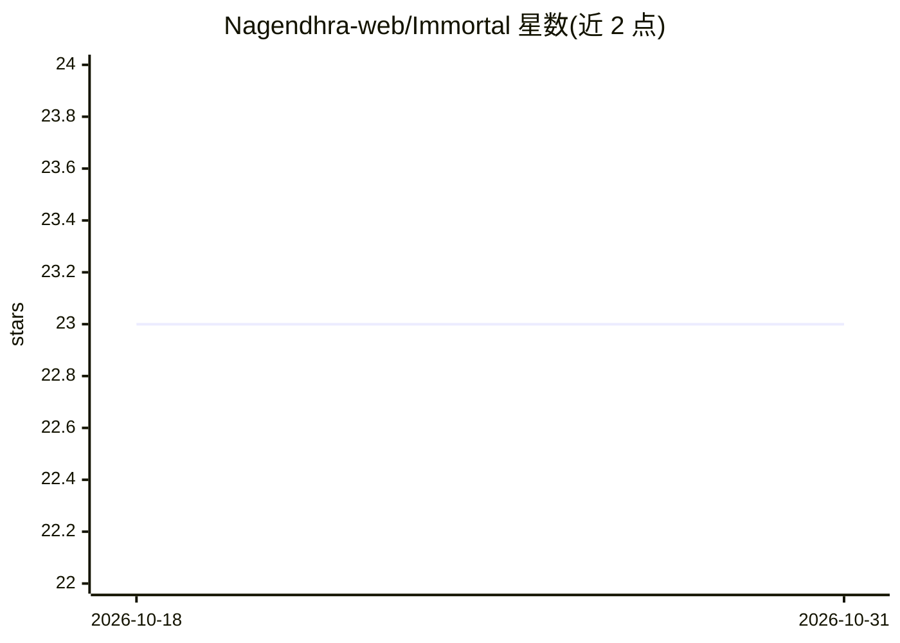

# Nagendhra-web/Immortal

⭐ 23 · Go · NOASSERTION · 推送 2026-06-21 · [GitHub](https://github.com/Nagendhra-web/Immortal) · [官网](https://nagendhra-web.github.io/Immortal/) · 个人维护

**面向基础设施的自主自愈引擎：毫秒级检测故障并自动修复**

以单个 Go 二进制交付的基础设施自愈引擎，包含 79 个 Go 包，内嵌零依赖的 12 视图操作仪表盘。故障处理分三层：规则化的反应式修复、基于线性回归与异常检测的预测性修复、以及 ReAct 式（计划-执行-观察-再规划）的智能体修复；辅以 LTL/CTL 形式化验证、PCMCI 因果根因分析、数字孪生仿真与后量子签名的防篡改审计链。面向运维/DevOps 场景，提供 CLI、31 个 REST 端点与 TypeScript/Python/Go 三种 SDK，支持 Docker 或源码安装。

## 筛选速览

| 维度 | 判定 | 备注 |
|---|---|---|
| AI 角色 | `ai-enhanced` | 去掉 AI 部分产品仍成立 |
| 许可风险 | `none` | NOASSERTION |
| 部署形态 | `library` | 以包/库形式分发 |
| 模型依赖 | — | README 未给出锁定关系 |
| 硬件要求 | — | 无带数字的原话,不猜 |
| 安装摩擦 | `low` | 无编译、无系统依赖或容器化 |
| 成熟度 | — | 结构信号不足 |

## 能力要点

- 三层自愈：规则式 + 预测式（回归/异常检测）+ ReAct 智能体循环
- LTL/CTL 模型检测、PCMCI 因果根因、数字孪生预演修复计划
- 哈希链 + Merkle 根 + 后量子签名的防篡改审计记录
- 单二进制零外部依赖，内嵌 12 视图操作台，79 个包可单独引用

## 适用场景

- 生产服务故障时自动检测、诊断并执行修复动作
- 3 AM 无人值守场景下自动处理已知与新类型故障
- 用数字孪生在执行前仿真验证修复计划
- 通过操作台查看因果根因链、ReAct 轨迹与审计记录

## 场景标签

 · 领域:基础设施运维/AIOps

## 证据(README 行号)

> L40: - **Reactive healing**: rule-based responses to known failure signatures.
> L127: |**Agentic healing loop**|`agentic`|ReAct-style Plan > Act > Observe > Re-plan until resolved.|

## 星数曲线

2026-10-18 23 → 2026-10-31 23（+0）

---
*卡片 v1 · prompt 1.4 · 生成 2026-10-27 · 置信度 mid · 依据 README sha `54fdc169e7e5` · [字段定义](../../DATASET.md)*
