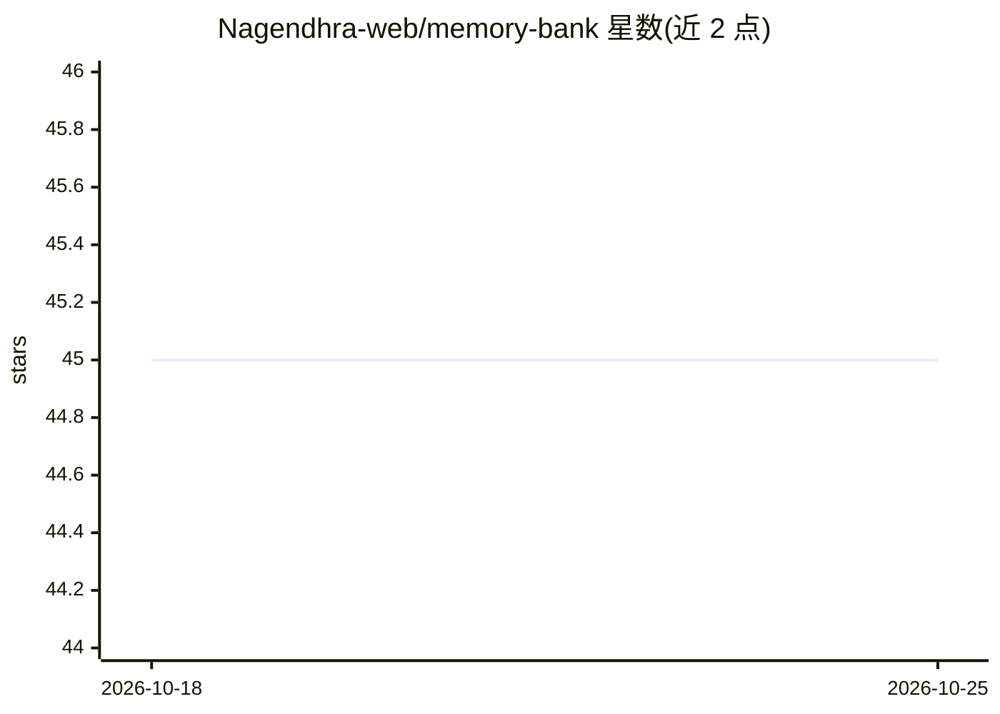

# Nagendhra-web/memory-bank

⭐ 46 · Python · Apache-2.0 · 推送 2026-04-15 · [GitHub](https://github.com/Nagendhra-web/memory-bank) · [官网](https://skills.sh/Nagendhra-web/memory-bank) · 个人维护

**Claude Code 的持久记忆技能：跨会话保持上下文并节省 token**

以 SKILL.md 技能形式安装到 Claude Code 的记忆管理层：会话结束将进度写入 MEMORY.md，下次会话自动加载，减少重复解释项目的开销。提供三层记忆架构（当前/项目/全局跨项目）、按 git 分支切换的记忆覆盖层、分级渐进加载（Tier 1-3）、智能压缩（超过 150 行自动压缩并归档）、会话差异比对（git 提交/文件重命名/依赖变化检测）、记忆健康评分与从代码重建的恢复模式、CONTINUATION.md 会话续接协议、交接文档生成与速度追踪。token 节省数据基于 tiktoken（cl100k_base）对示例文件测量。Apache 2.0 许可。

## 筛选速览

| 维度 | 判定 | 备注 |
|---|---|---|
| AI 角色 | `ai-ecosystem` | LLM/agent 周边工具 |
| 许可风险 | `permissive` | Apache-2.0 |
| 部署形态 | `library` | 以包/库形式分发 |
| 模型依赖 | — | README 未给出锁定关系 |
| 硬件要求 | — | 无带数字的原话,不猜 |
| 安装摩擦 | `low` | 无编译、无系统依赖或容器化 |
| 成熟度 | — | 结构信号不足 |

## 能力要点

- 三层记忆架构：当前任务/项目/全局跨项目偏好
- 分支感知记忆：按 git 分支加载与合并记忆覆盖层
- 渐进式分级加载与紧凑编码（表格优先）控制 token 用量
- 会话差异比对 + 健康评分 + 恢复模式（从代码重建记忆）

## 适用场景

- Claude Code 长期项目开发中保留跨会话上下文
- 多分支并行开发时自动切换对应项目记忆
- 上下文接近上限时通过 CONTINUATION.md 无缝续接新会话
- 为新成员生成项目交接文档

## 场景标签

`Agent 记忆` · 领域:Agent 开发

## 证据(README 行号)

> L88: npx skills add Nagendhra-web/memory-bank
> L295:     SKILL.md                          ← Core skill (the engine)
> L13: **Your Claude Code sessions die too fast. You waste tokens re-explaining your project every time.**

## 星数曲线

2026-10-18 45 → 2026-10-25 45（+0）

---
*卡片 v1 · prompt 1.4 · 生成 2026-10-25 · 置信度 high · 依据 README sha `b03a171d6dc5` · [字段定义](../../DATASET.md)*
