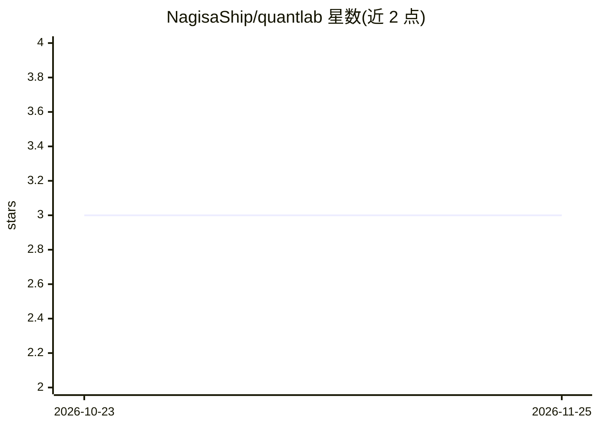

# NagisaShip/quantlab

⭐ 3 · Python · MIT · 推送 2026-10-31 · [GitHub](https://github.com/NagisaShip/quantlab) · [官网](https://codespaces.new/NagisaShip/quantlab) · 个人维护 · 中文 README

**面向加密货币的自托管 AI 原生量化研究与验证平台**

QuantLab 是自托管的加密货币量化研究平台：用户在「AI 研究室」以对话描述研究目标，Agent 在 51 个工具上完成写策略、跑回测、因子评估、模型训练与执行仿真，结论附带代码哈希、参数与数据来源等可复现记录。流程包含 16 个内置角色并行评审、Research Review Gate 审查卡、纸面模拟与交易所模拟盘验证；真实资金通道（微实盘/真实永续）默认关闭，需多项开关与确认码。Docker Compose 部署或脚本单机启动，无模型密钥也可启动。

## 筛选速览

| 维度 | 判定 | 备注 |
|---|---|---|
| AI 角色 | `ai-native` | 本体是模型或模型工具 |
| 许可风险 | `permissive` | MIT |
| 部署形态 | `self-host` | docker 或自建部署 |
| 模型依赖 | local-ok | 支持本地模型 |
| 硬件要求 | — | 无带数字的原话,不猜 |
| 安装摩擦 | `low` | 无编译、无系统依赖或容器化 |
| 成熟度 | `idea` | |

## 能力要点

- 对话式研究：Agent 选择工具、写策略、跑回测并输出可复现结论
- Research Review Gate 审查卡（通过/不通过/证据不足），高严重度问题阻断晋级
- 回测、纸面模拟、交易所模拟盘三关上线验证；真实资金通道默认关闭
- 策略支持规则 DSL 表单与 Python SDK，兼容 Freqtrade 策略包导入

## 适用场景

- 在自托管环境中做加密货币策略回测与稳健性检验
- 通过多 Agent 评审对策略研究结论做审查与留痕
- 在纸面模拟和交易所模拟盘上验证策略后再决定是否实盘

## 场景标签

`金融量化` `多智能体` · 领域:Agent 开发

## 证据(README 行号)

> L5: 面向加密货币的 AI 原生量化研究台：对话式研究、多 Agent 协作、回测与稳健性检验、纸面模拟、交易所模拟盘和受控实盘验证。
> L50: - AI 在平台的 51 个工具上调行情、写策略、跑回测、评估因子、训练模型、做组合优化与执行仿真；
> L107: 支持 DeepSeek、通义千问、Kimi、智谱、OpenAI 兼容接口、Anthropic、Ollama、vLLM 等。

## 星数曲线

2026-10-23 3 → 2026-11-25 3（+0）

---
*卡片 v1 · prompt 1.4 · 生成 2026-11-22 · 置信度 high · 依据 README sha `c4a4cca69d2a` · [字段定义](../../DATASET.md)*
