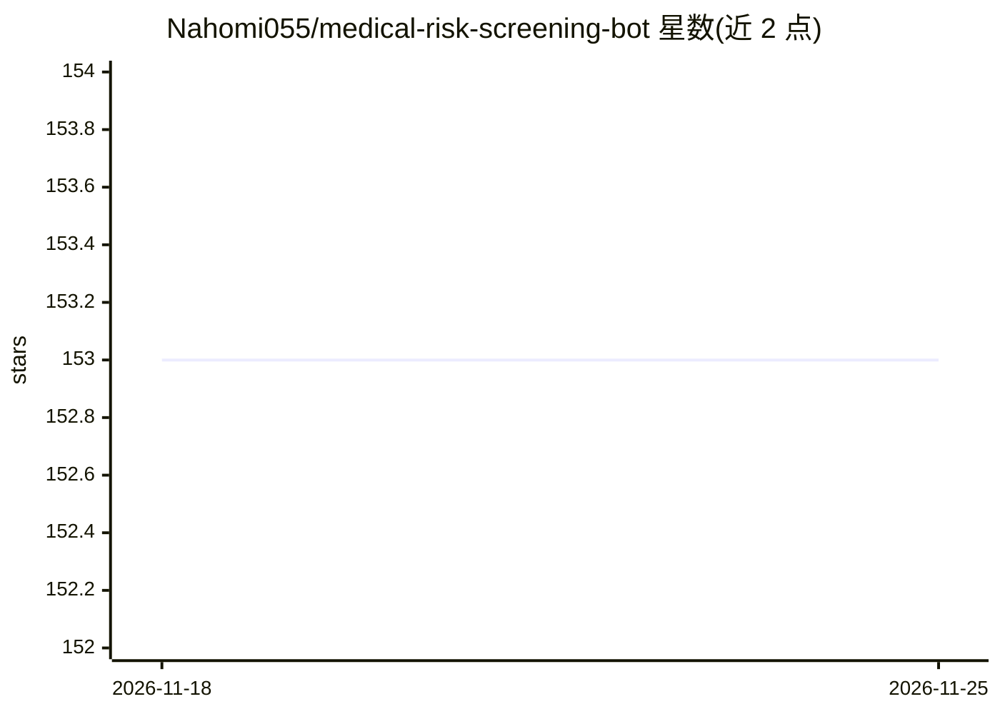

# Nahomi055/medical-risk-screening-bot

⭐ 153 · TypeScript · MIT · 推送 2026-11-23 · [GitHub](https://github.com/Nahomi055/medical-risk-screening-bot) · 个人维护

**社区驱动的 Telegram 机器人：糖尿病与心脏病早期风险初筛**

面向 Telegram 用户的双项健康风险初筛机器人：内置分别训练的 XGBoost 分类器，通过逐题问答采集信息，生成糖尿病或心脏病的风险概率估计并附通俗解释。关键机制包括：结果前回显用户全部作答以便核对、优先加载 XGBoost 原生 JSON 模型（pickle 兜底）、缺失特征时拒绝启动、本地轮转日志记录操作、模块化测试注册便于社区新增筛查项。README 明确声明这是学生机器学习项目，属非正式筛查而非诊断工具，每条结果自动附带医疗免责声明。全部运行在用户自有实例上，答案不发送第三方。

## 筛选速览

| 维度 | 判定 | 备注 |
|---|---|---|
| AI 角色 | `ai-native` | 本体是模型或模型工具 |
| 许可风险 | `permissive` | MIT |
| 部署形态 | `None` |  |
| 模型依赖 | — | README 未给出锁定关系 |
| 硬件要求 | — | 无带数字的原话,不猜 |
| 安装摩擦 | `low` | 无编译、无系统依赖或容器化 |
| 成熟度 | `idea` | |

## 能力要点

- 糖尿病与心脏病双 XGBoost 模型，输出风险概率与通俗解释
- 结果前回显全部作答，支持改错重跑
- 模型模块化：新增筛查项只需注册一个含 predict 函数的模块
- JSON 优先加载、缺失特征即拒绝启动的防护机制

## 适用场景

- 通过 Telegram 逐题问答做糖尿病或心脏病早期风险自查
- 学生/社区学习模块化机器学习项目结构
- 在其框架上贡献新的健康筛查模块

## 场景标签

 · 领域:健康/医疗筛查应用

## 证据(README 行号)

> L7: Medical Risk Screening Bot is a friendly, community-driven Telegram companion for quick and informal early risk chec
> L20: - **📊 XGBoost under the hood** — both screenings run on trained gradient-boosted models, so you get a probability e

## 星数曲线

2026-11-18 153 → 2026-11-25 153（+0）

---
*卡片 v1 · prompt 1.4 · 生成 2026-11-18 · 置信度 high · 依据 README sha `f536811465d2` · [字段定义](../../DATASET.md)*
