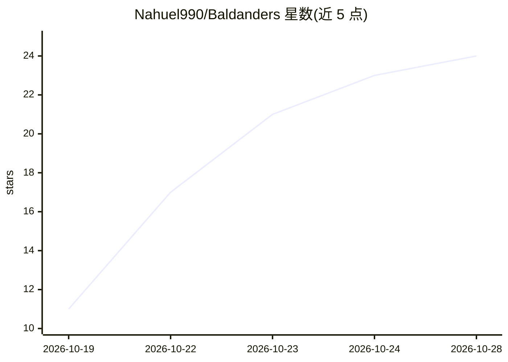

# Nahuel990/Baldanders

⭐ 24 · Python · MIT · 推送 2026-10-17 · [GitHub](https://github.com/Nahuel990/Baldanders) · [官网](https://pypi.org/project/baldanders/) · 个人维护

**本地个人数据防火墙：云端 LLM 对话前自动脱敏 PII 并回填**

运行在本地的代理层，用户照常使用 Claude Code、Codex CLI 或 grok-cli 等云端编码助手：消息发出前在本地将姓名、邮箱、55+ 种国家身份证号、银行卡、IBAN、密钥等替换为 [PERSON_1] 类令牌，回复到达后再换回真实值，令牌映射不出本机。检测分三层：自定义规则、确定性校验器（libphonenumber、python-stdnum 等）、可选多语言姓名/地址 NER 模型（约 320MB，PyTorch 约 1GB）。会话文件用系统钥匙串密钥加密；作者声明不接收 PR，且各检测器非完备、异常格式可能漏检。

## 筛选速览

| 维度 | 判定 | 备注 |
|---|---|---|
| AI 角色 | `ai-ecosystem` | LLM/agent 周边工具 |
| 许可风险 | `permissive` | MIT |
| 部署形态 | `library` | 以包/库形式分发 |
| 模型依赖 | locked-api |  |
| 硬件要求 | — | 无带数字的原话,不猜 |
| 安装摩擦 | `low` | 无编译、无系统依赖或容器化 |
| 成熟度 | — | 结构信号不足 |

## 能力要点

- 三层本地检测：自定义规则 + 校验和验证的确定性检测器 + 可选 20+ 语言姓名/地址 NER 模型
- 通过现有订阅登录接入 Claude Code / Codex / Grok，无需 API key
- 会话加密存储，密钥存于系统钥匙串；-v 可查看实际外发的每个字节
- baldanders scrub 子命令可脱离 AI 用于脚本与流水线的文本脱敏

## 适用场景

- 让员工在真实客户数据上使用已订阅的云端编码助手而不外泄 PII
- 合规（GDPR 等）要求下将敏感数据挡在本机再调用 LLM
- 在脚本/流水线中对文本做 PII 脱敏与结构化输出

## 场景标签

 · 领域:AI 安全/隐私工程

## 证据(README 行号)

> L12: Baldanders is a local personal-data firewall for cloud LLMs. You use Claude Code, Codex or Grok as usual. Names, em
> L43: baldanders                      # Claude Code (default), via your Claude login (no API key)
> L44: baldanders -p codex             # OpenAI Codex CLI, via your ChatGPT login (no API key)

## 星数曲线

2026-10-19 11 → 2026-10-28 24（+13）

---
*卡片 v1 · prompt 1.4 · 生成 2026-10-27 · 置信度 mid · 依据 README sha `340fd5e15279` · [字段定义](../../DATASET.md)*
