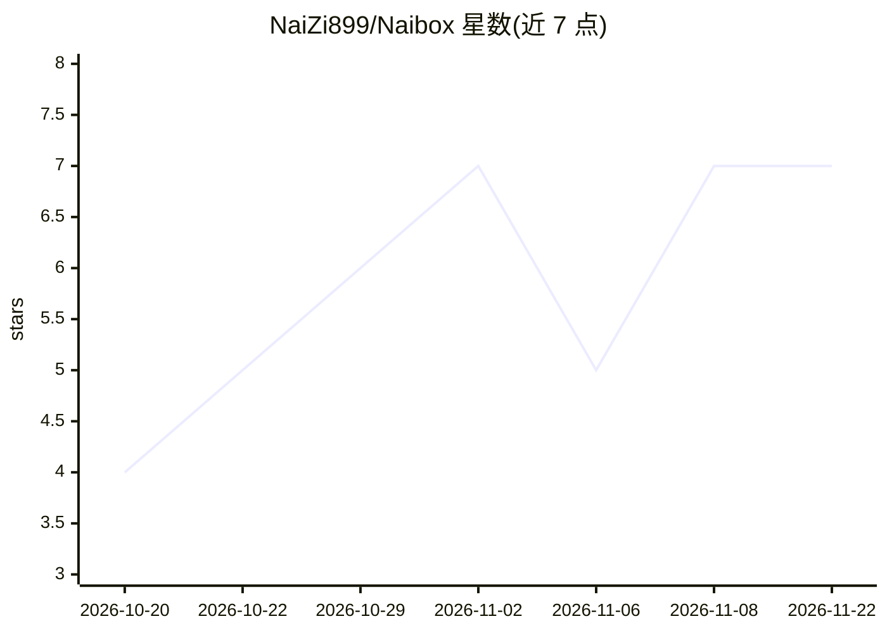

# NaiZi899/Naibox

⭐ 7 · Go · NOASSERTION · 推送 2026-11-16 · [GitHub](https://github.com/NaiZi899/Naibox) · 个人维护 · 中文 README

**把多个上游账号聚合成 OpenAI 兼容接口的本地 AI 网关**

Go 编写的本地 AI 网关，Windows 桌面版与 Linux/macOS 服务端共用装配，对外提供单一 OpenAI 兼容 base_url 与 api_key。内置 12 个上游（含浏览器授权、设备码、手机验证码、API Key 批量导入等凭证类型），也可接入任意 OpenAI 兼容端点；由网关处理选号、冷却、熔断、重试、续期与模型目录。控制台提供仪表盘、账号池、请求日志、对话测试等页面。明确不提供多租户与计费，管理接口仅限本机访问。

## 筛选速览

| 维度 | 判定 | 备注 |
|---|---|---|
| AI 角色 | `ai-ecosystem` | LLM/agent 周边工具 |
| 许可风险 | `none` | NOASSERTION |
| 部署形态 | `desktop` | 安装包/桌面程序 |
| 模型依赖 | — | README 未给出锁定关系 |
| 硬件要求 | — | 无带数字的原话,不猜 |
| 安装摩擦 | `low` | 无编译、无系统依赖或容器化 |
| 成熟度 | — | 结构信号不足 |

## 能力要点

- 内置 12 个上游并支持自定义 OpenAI 兼容端点
- 账号池按健康状态、在途名额与会话粘性选号
- 提供 /v1/chat/completions、/v1/models、生图等 OpenAI 兼容接口
- Windows 桌面版（WebView2+托盘）与服务端（Docker/二进制）两种形态

## 适用场景

- 多账号统一为一个地址和 key 调用
- 在个人电脑桌面常驻网关供本地客户端使用
- 在服务器或 NAS 上长期运行聚合多个上游

## 场景标签

`模型网关` · 领域:Agent 开发

## 证据(README 行号)

> L14: NaiBox 是一个 Go 编写的本地 AI 网关，Windows 桌面版与 Linux/macOS 服务端共用同一套装配，对外提供一个 OpenAI 兼容的 `base_url` 和 `api_key`。
> L16: 内置 12 个上游，也能接入任意 OpenAI 兼容端点。客户端只配一个地址和一把 key，选号、冷却、重试、续期、模型目录由网关处理。

## 星数曲线

2026-10-20 4 → 2026-11-22 7（+3）

---
*卡片 v1 · prompt 1.4 · 生成 2026-11-20 · 置信度 high · 依据 README sha `3e50cfd988d3` · [字段定义](../../DATASET.md)*
