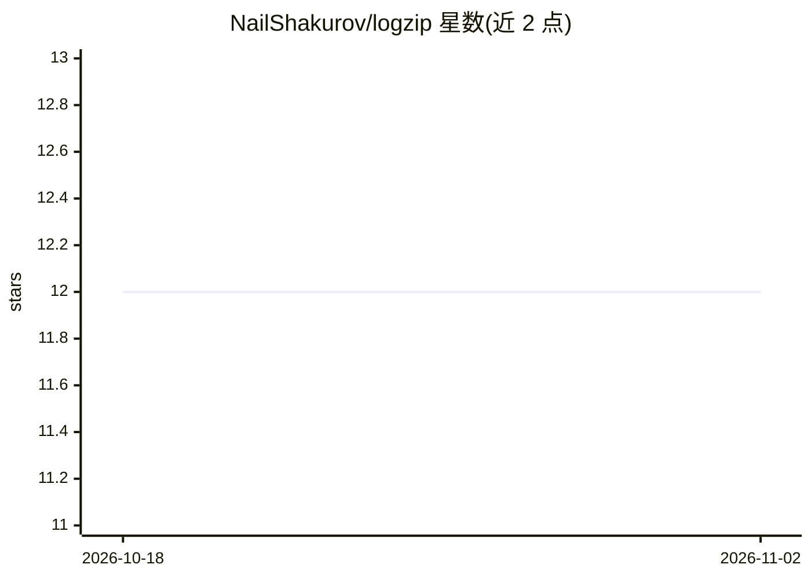

# NailShakurov/logzip

⭐ 12 · Rust · MIT · 推送 2026-06-08 · [GitHub](https://github.com/NailShakurov/logzip) · [官网](https://pypi.org/project/logzip/) · 个人维护

**给开发者的日志压缩工具：LLM 分析前压缩日志省 token**

logzip 是用 Rust 编写、通过 PyO3 提供 Python API 的日志压缩工具，在将日志发送给 LLM（Claude Code / Cursor / API）或 RAG 管线前，将重复日志行压缩为带 LEGEND 的结构化文本，实测对结构化日志（systemd、uvicorn、docker）典型节省 52–58%。提供 fast/balanced/max 多种质量档位与可选第二遍压缩，默认有损语义压缩（裁剪亚秒时间戳、合并空白），可用 --lossless 做字节级往返。核心逻辑纯 Rust、无 unsafe 块，附带双 CLI、MCP Server（供 Claude Desktop/Claude Code 调用）与 Claude Code 插件安装方式。

## 筛选速览

| 维度 | 判定 | 备注 |
|---|---|---|
| AI 角色 | `ai-ecosystem` | LLM/agent 周边工具 |
| 许可风险 | `permissive` | MIT |
| 部署形态 | `library` | 以包/库形式分发 |
| 模型依赖 | locked-api |  |
| 硬件要求 | — | 无带数字的原话,不猜 |
| 安装摩擦 | `low` | 无编译、无系统依赖或容器化 |
| 成熟度 | — | 结构信号不足 |

## 能力要点

- 压缩后输出仍是人类与 LLM 可读的结构化文本，异常行保持原样可见
- 多质量档位与 BPE 第二遍压缩，7.96MB 日志基准节省最高 ≥58%
- 提供 MCP Server（compress/get_stats/compress_tail 等工具）与 Claude Code 插件
- 核心为纯 Rust、零 unsafe，支持多 GB 日志无泄漏压测

## 适用场景

- 把大日志压缩后再发给 Claude Code 或 Cursor 做 LLM 分析，节省 token
- RAG 管线中压缩日志上下文并突出异常
- 通过 MCP 让 Claude 直接读取并分析 /var/log 下的服务器日志

## 场景标签

 · 领域:开发者工具/LLM 日志处理

## 证据(README 行号)

> L9: Compress logs **before** sending to LLM. Powered by Rust & PyO3.
> L43: `logzip` is well-suited for **RAG pipelines**: it compresses the context before sending it to the model, saving mon

## 星数曲线

2026-10-18 12 → 2026-11-02 12（+0）

---
*卡片 v1 · prompt 1.4 · 生成 2026-11-01 · 置信度 high · 依据 README sha `94fbc53bf53f` · [字段定义](../../DATASET.md)*
