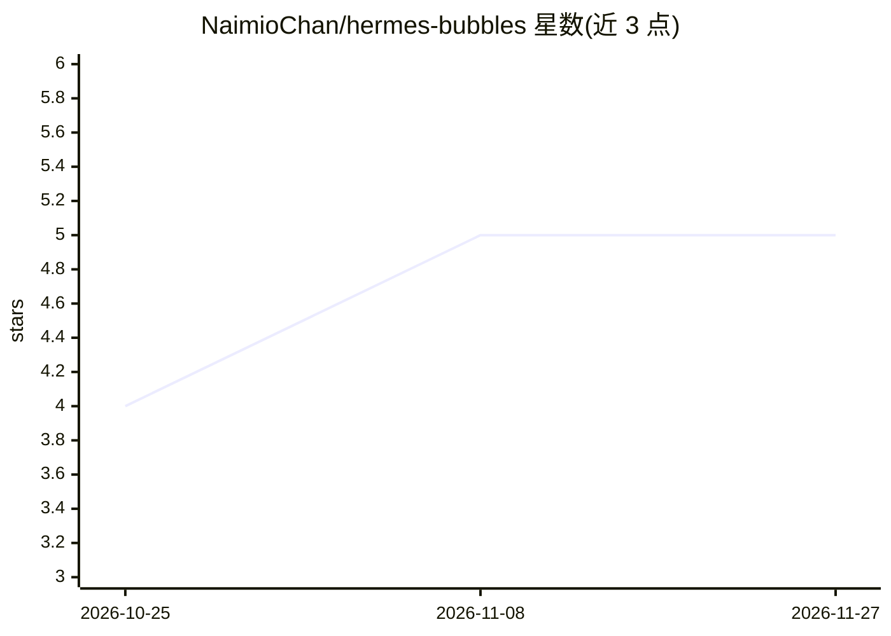

# NaimioChan/hermes-bubbles

⭐ 5 · TypeScript · MIT · 推送 2026-11-13 · [GitHub](https://github.com/NaimioChan/hermes-bubbles) · 个人维护

**为 Hermes 仪表盘替换 /chat 的气泡式流式聊天插件**

Hermes Agent web 仪表盘的插件，将内置的 xterm.js 终端式 /chat 页面替换为原生消息流界面：每条回复、工具调用与审批请求各占独立气泡，流式输出在所属气泡内追加。通信不经 PTY，直接使用仪表盘的 tui_gateway JSON-RPC socket，处理 message.delta、tool.start/complete、approval 等结构化事件。功能覆盖 Markdown 渲染、工具卡片、会话历史、多会话标签、附件、模型/推理档位切换、用量指标与移动端布局。安装需已有 Hermes 仪表盘（验证于 0.22.2），经 hermes plugins install 或源码构建两种途径。

## 筛选速览

| 维度 | 判定 | 备注 |
|---|---|---|
| AI 角色 | `ai-enhanced` | 去掉 AI 部分产品仍成立 |
| 许可风险 | `permissive` | MIT |
| 部署形态 | `library` | 以包/库形式分发 |
| 模型依赖 | — | README 未给出锁定关系 |
| 硬件要求 | — | 无带数字的原话,不猜 |
| 安装摩擦 | `low` | 无编译、无系统依赖或容器化 |
| 成熟度 | — | 结构信号不足 |

## 能力要点

- 经 tui_gateway JSON-RPC socket 接收结构化事件，流式气泡渲染
- 工具调用卡片、审批/澄清卡片、思考块折叠展示
- 多会话标签、会话历史投影、会话内容拖入输入框作上下文
- 附件（图片/PDF/文件）、桌面通知与移动端抽屉式布局

## 适用场景

- 以消息气泡界面替代终端式 /chat 使用 Hermes 仪表盘
- 在手机或窄屏上管理 Hermes agent 会话与审批
- 查看每次回复的工具调用、思考过程与用量指标

## 场景标签

`聊天机器人` · 领域:对话与助手

## 证据(README 行号)

> L3: A bubble-style chat page for the **Hermes** web dashboard (`hermes dashboard`).
> L7: It does not go through a PTY. It speaks the dashboard's own `tui_gateway` JSON-RPC socket (`/api/ws`) — the same cha
> L48: - Hermes Agent web dashboard, tested against **0.22.2**

## 星数曲线

2026-10-25 4 → 2026-11-27 5（+1）

---
*卡片 v1 · prompt 1.4 · 生成 2026-11-21 · 置信度 high · 依据 README sha `d9cf8538ff1c` · [字段定义](../../DATASET.md)*
