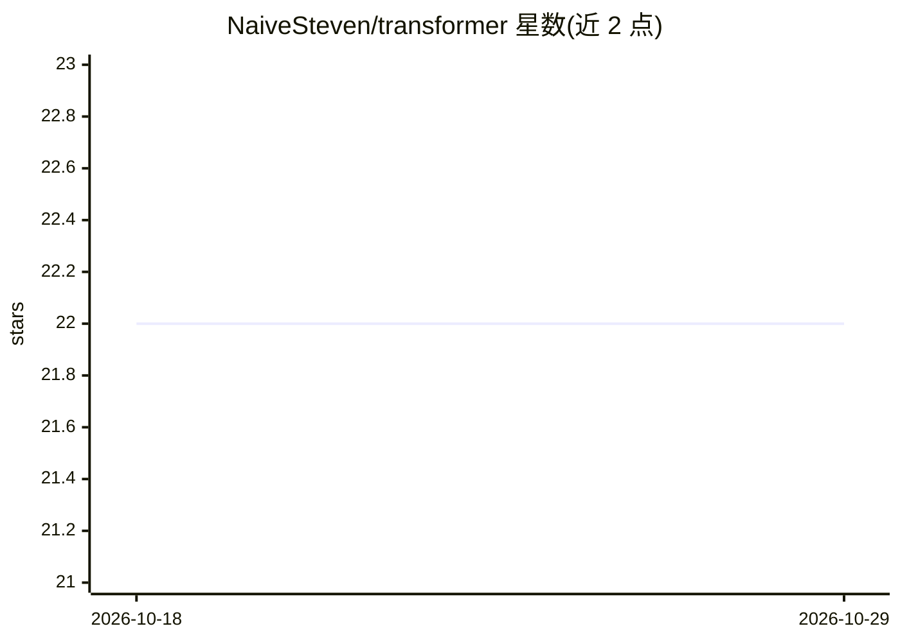

# NaiveSteven/transformer

⭐ 22 · TypeScript · 推送 2026-04-10 · [GitHub](https://github.com/NaiveSteven/transformer) · 个人维护 · 中文 README

**本地 AI 实时对话翻译桌面应用：离线语音转写与互译**

基于 Electron + React 的桌面应用，面向需要跨语言对话的个人用户：按住麦克风说话，Whisper 模型本地实时转写，再经 Opus-MT / NLLB-200 本地推理翻译，支持中英日韩法德俄西意 9 种语言互译。所有推理在本地完成，无需联网与上传；模型按需下载缓存，对话记录存本地 SQLite（sql.js WASM）。AI 推理基于 @huggingface/transformers 与 ONNX Runtime Web，用 Web Workers 做非阻塞推理；界面中英双语。安装与打包通过 pnpm 完成。

## 筛选速览

| 维度 | 判定 | 备注 |
|---|---|---|
| AI 角色 | `ai-native` | 本体是模型或模型工具 |
| 许可风险 | `none` | — |
| 部署形态 | `library` | 以包/库形式分发 |
| 模型依赖 | — | README 未给出锁定关系 |
| 硬件要求 | — | 无带数字的原话,不猜 |
| 安装摩擦 | `low` | 无编译、无系统依赖或容器化 |
| 成熟度 | — | 结构信号不足 |

## 能力要点

- Whisper Tiny/Base/Small 本地语音转写（模型按需下载）
- Opus-MT 与 NLLB-200-Distilled-600M 离线翻译，9 种语言互译
- 推理全部本地完成（ONNX Runtime Web + Web Workers 非阻塞）
- 对话记录本地 SQLite 存储，中英双语界面

## 适用场景

- 跨语言面对面交流时做实时语音翻译
- 在无网络或注重隐私的环境下离线翻译对话
- 回顾历史翻译对话记录

## 场景标签

`语音识别` · 领域:感知与多模态

## 证据(README 行号)

> L3: **本地 AI 驱动的实时对话翻译桌面应用**
> L11: - **🎙️ 语音转文字** — 按住麦克风说话，Whisper 模型实时转写
> L12: - **🌐 离线翻译** — Marian MT / NLLB 本地推理，9 种语言互译

## 星数曲线

2026-10-18 22 → 2026-10-29 22（+0）

---
*卡片 v1 · prompt 1.4 · 生成 2026-10-27 · 置信度 high · 依据 README sha `07dc48927e47` · [字段定义](../../DATASET.md)*
