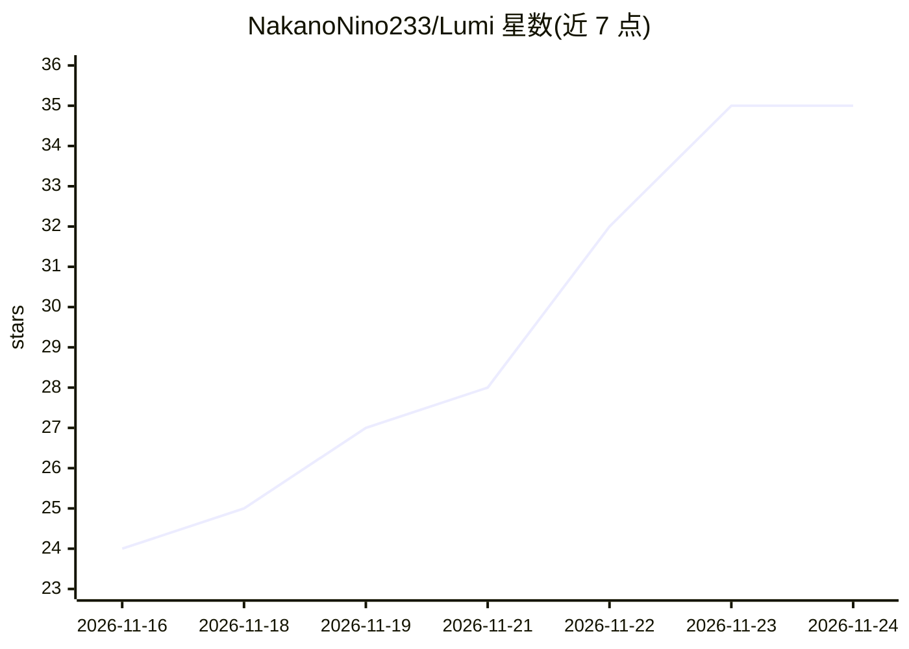

# NakanoNino233/Lumi

⭐ 35 · Swift · NOASSERTION · 推送 2026-11-16 · [GitHub](https://github.com/NakanoNino233/Lumi) · [官网](https://github.com/NakanoNino233/Lumi/releases/latest) · 个人维护 · 中文 README

**原生 iOS/Android AI 好友应用：自定义人设、本地记忆与朋友圈**

面向终端用户的双平台 AI 陪伴应用，iOS 用 SwiftUI、Android 用 Jetpack Compose 分别开发。用户可自定义角色人设与外观，聊天支持流式回复、图片附件、语音输入，并将对话沉淀为本地记忆、日记、纪念日与关系进度，另有好友朋友圈动态。模型不内置，需自备 API Key，兼容 OpenAI Chat Completions、Anthropic Messages 及自定义服务地址。数据保存在本机，iOS 用钥匙串、Android 用 Keystore 存储 Key。源码采用 PolyForm 非商业许可，历史 1.0.0 版本为 MIT。

## 筛选速览

| 维度 | 判定 | 备注 |
|---|---|---|
| AI 角色 | `ai-native` | 本体是模型或模型工具 |
| 许可风险 | `none` | NOASSERTION |
| 部署形态 | `None` |  |
| 模型依赖 | — | README 未给出锁定关系 |
| 硬件要求 | — | 无带数字的原话,不猜 |
| 安装摩擦 | `medium` | 含编译或系统依赖之一 |
| 成熟度 | — | 结构信号不足 |

## 能力要点

- 自定义好友人设与 JSON 好友卡导入导出
- 本地记忆、日记、纪念日与朋友圈动态
- 兼容 OpenAI Chat Completions、Anthropic Messages 与自定义服务地址
- 双平台原生开发（SwiftUI / Jetpack Compose），APK 与 IPA 统一发布

## 适用场景

- 在手机上和自定义人设的 AI 好友日常聊天
- 把与 AI 的相处记录为记忆、日记与纪念日
- 通过朋友圈动态记录和分享生活片段

## 场景标签

`聊天机器人` · 领域:对话与助手

## 证据(README 行号)

> L20: Lumi 是一款原生 iOS / Android AI 好友应用。从内置好友「大肥鱼」开始，也可以创造自己的角色：聊一段日常，留下一点记忆，再把生活的小片段放进朋友圈。
> L71: |自选模型服务|兼容 OpenAI Chat Completions、Anthropic Messages 与自定义服务地址|

## 星数曲线

2026-11-16 24 → 2026-11-24 35（+11）

---
*卡片 v1 · prompt 1.4 · 生成 2026-11-18 · 置信度 high · 依据 README sha `73555f86e8aa` · [字段定义](../../DATASET.md)*
