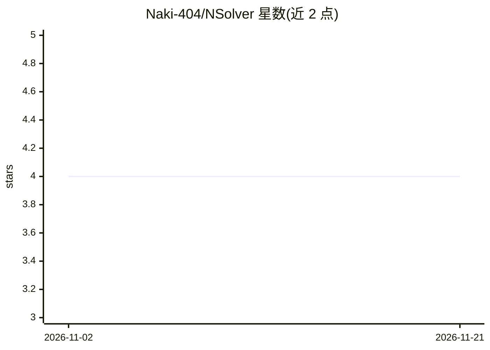

# Naki-404/NSolver

⭐ 4 · JavaScript · 推送 2026-11-15 · [GitHub](https://github.com/Naki-404/NSolver) · [官网](https://github.com/Naki-404/NSolver) · 个人维护

**用 AI 自动作答 Coursera 与 Cisco NetAcad 测验的 Chrome 扩展**

Manifest V3 的 Chrome 扩展：读取页面上打开的测验题目（含 NetAcad 的 iframe 与 Shadow DOM），将题目连同课程材料片段发送到用户所选的 AI API，自动勾选单选、多选、填空与下拉答案。支持 Jupyter 编程作业代写、Coursera 互评作业撰写与批改、逐模块自动通关与自动重考，并将 Coursera 讲义标记为已完成。提供 5 个 API 通道、快捷键与 RU/EN 界面；扩展自身不提交测验，需用户自行发送。README 提示自动完成计分作业可能违反 Coursera Honor Code。

## 筛选速览

| 维度 | 判定 | 备注 |
|---|---|---|
| AI 角色 | `ai-native` | 本体是模型或模型工具 |
| 许可风险 | `none` | — |
| 部署形态 | `None` |  |
| 模型依赖 | locked-api |  |
| 硬件要求 | — | 无带数字的原话,不猜 |
| 安装摩擦 | `low` | 无编译、无系统依赖或容器化 |
| 成熟度 | — | 结构信号不足 |

## 能力要点

- 5 个可选 API 通道（OctavAPI、SyncAPI、Claude、ChatGPT、Gemini），各自存键并可拉取模型列表
- 支持单选/多选/文本/下拉等题型自动作答，打开尝试页即自动求解
- Jupyter 编程作业代写并按测试修正后提交
- 互评作业：生成并提交作品，按评分规则批改同学作业

## 适用场景

- 让 AI 代答 Coursera 测验并核对后提交
- 自动通过 Cisco NetAcad 全部课程模块
- 让 AI 撰写并提交 Coursera 编程与互评作业

## 场景标签

 · 领域:教育/浏览器工具

## 证据(README 行号)

> L15: - **Quiz Solver.** Берёт вопросы открытой попытки теста, отправляет их выбранной модели и сам отмечает ответы: один
> L24: - **Пять API на выбор:** OctavAPI, SyncAPI, Claude API, ChatGPT API и Gemini API. Для каждого хранится свой ключ и 

## 星数曲线

2026-11-02 4 → 2026-11-21 4（+0）

---
*卡片 v1 · prompt 1.4 · 生成 2026-11-21 · 置信度 high · 依据 README sha `d114fa04eb6e` · [字段定义](../../DATASET.md)*
