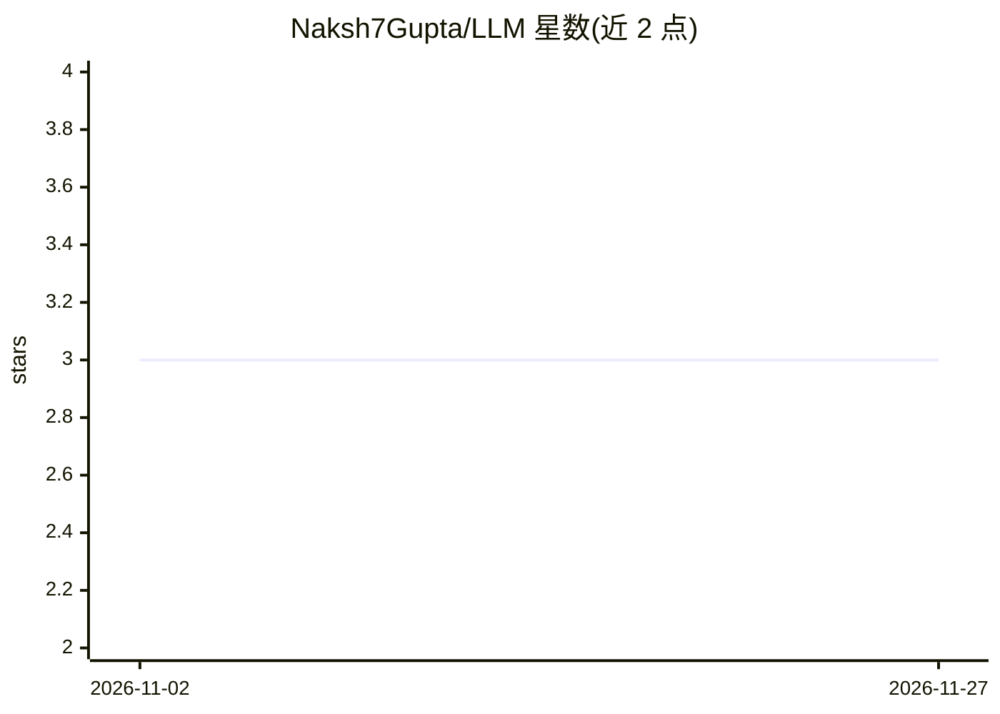

# Naksh7Gupta/LLM

⭐ — · [GitHub]() · 个人维护

**从零实现的 PyTorch decoder-only LLM 训练框架**

用 PyTorch 从零构建的 decoder-only 大语言模型实现，采用参考 LLaMA/Mistral 的架构组件（RoPE、GQA、SwiGLU、RMSNorm、权重绑定）。提供端到端流程：FineWeb-Edu 语料抓取、自训练 BPE 分词器、混合精度（AMP FP16）与梯度累积训练循环、检查点保存和自回归文本生成。预训练推荐 NVIDIA GPU（CUDA 11.8+ 或 12.x），CPU 仅支持测试运行；通过环境变量可覆盖训练超参数。

## 筛选速览

| 维度 | 判定 | 备注 |
|---|---|---|
| AI 角色 | `ai-native` | 本体是模型或模型工具 |
| 许可风险 | `permissive` | — |
| 部署形态 | `library` | 以包/库形式分发 |
| 模型依赖 | — | README 未给出锁定关系 |
| 硬件要求 | — | 无带数字的原话,不猜 |
| 安装摩擦 | `medium` | 含编译或系统依赖之一 |
| 成熟度 | — | 结构信号不足 |

## 能力要点

- 实现 RoPE/GQA/SwiGLU/RMSNorm 等 LLaMA/Mistral 风格架构组件
- AMP FP16 混合精度与梯度累积训练循环，含中期生成监控
- 端到端流程覆盖 FineWeb-Edu 语料采集、BPE 分词、训练与生成
- 通过环境变量覆盖训练超参数，无需改代码

## 适用场景

- 学习 decoder-only Transformer 的完整实现细节
- 在自定义语料上从头预训练小型 LLM
- 验证 RoPE、GQA 等架构组件的张量行为

## 场景标签

`模型训练` `教程课程` · 领域:学习与行业

## 证据(README 行号)

> L9: A modern, high-performance **decoder-only Large Language Model (LLM)** built from scratch in PyTorch. **ThinkNet Tra
> L28: - **End-to-End Pipeline**: Includes corpus harvesting, custom Byte-Pair Encoding (BPE) tokenization, dataset serial
> L155: Generate text autoregressively using a trained checkpoint:

## 星数曲线

2026-11-02 3 → 2026-11-27 3（+0）

---
*卡片 v1 · prompt 1.4 · 生成 2026-11-22 · 置信度 high · 依据 README sha `af791d8f36ff` · [字段定义](../../DATASET.md)*
