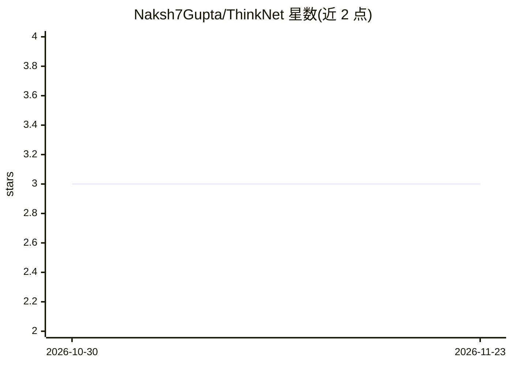

# Naksh7Gupta/ThinkNet

⭐ 3 · TypeScript · Apache-2.0 · 推送 2026-10-30 · [GitHub](https://github.com/Naksh7Gupta/ThinkNet) · 个人维护

**为学习者/研究者提供可视化设计训练 AI 模型的桌面工作台**

一个处于早期开发阶段的桌面 AI 工程工作区，规划了可视化模型设计、算力估算、AI 工程 Agent、数据集与 tokenizer 检查、训练评估流水线以及机器人 AI 等模块。技术栈为 Electron 桌面壳 + Web UI + FastAPI/Python 后端，AI 负载运行在隔离的 Python/C++ 进程中。README 明确声明多数能力为规划方向而非已实现功能，需从源码用 npm 与 Python 虚拟环境安装运行。

## 筛选速览

| 维度 | 判定 | 备注 |
|---|---|---|
| AI 角色 | `ai-ecosystem` | LLM/agent 周边工具 |
| 许可风险 | `permissive` | Apache-2.0 |
| 部署形态 | `library` | 以包/库形式分发 |
| 模型依赖 | — | README 未给出锁定关系 |
| 硬件要求 | — | 无带数字的原话,不猜 |
| 安装摩擦 | `low` | 无编译、无系统依赖或容器化 |
| 成熟度 | `idea` | |

## 能力要点

- 可视化配置模型组件与 Transformer 架构的工作流（规划中）
- 跨硬件配置的算力与内存需求估算器
- AI 工程 Agent 与多 Agent 协作工作流（规划中）
- Electron 桌面壳 + FastAPI 后端的 monorepo 结构

## 适用场景

- 以图形界面方式配置和检查模型实验而非从零写脚本
- 在提交训练前估算实验所需算力与内存
- 学习 AI 系统如何组装并理解各模块行为

## 场景标签

`模型训练` · 领域:训练与推理

## 证据(README 行号)

> L8:  An engineering workspace for building, understanding, and experimenting with AI.
> L20: > **Project status:** ThinkNet is in early development. The capabilities described below represent the project's di
> L82: |AI ecosystem|**PyTorch and task-specific libraries**|Model development and specialized AI workflows|

## 星数曲线

2026-10-30 3 → 2026-11-23 3（+0）

---
*卡片 v1 · prompt 1.4 · 生成 2026-11-22 · 置信度 high · 依据 README sha `01dda8441e0a` · [字段定义](../../DATASET.md)*
