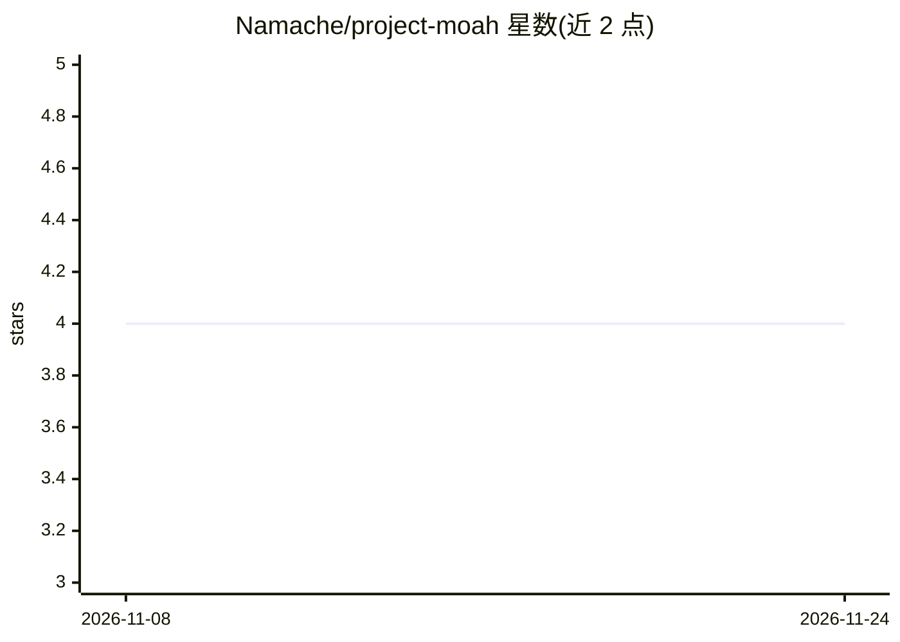

# Namache/project-moah

⭐ 4 · Python · MIT · 推送 2026-11-10 · [GitHub](https://github.com/Namache/project-moah) · 个人维护

**给 AI 编码 Agent 提供本地共享记忆与任务管理的桌面应用**

一个 100% 本地运行的桌面应用（Windows 安装包、.deb、Flatpak），通过 MCP server 为 Claude Code、Codex 等 Agent 提供共享记忆库与任务看板：以带权重链接的记录存储任务、决策、规则与事实，会话开始时按链接相关性生成上下文简报，降低每会话 token 消耗；支持锁定关键规则、人工审核 Agent 产出、检查点交接、以及本地语音听写。无账号、无云端、无遥测，数据可导出为单文件备份。

## 筛选速览

| 维度 | 判定 | 备注 |
|---|---|---|
| AI 角色 | `ai-ecosystem` | LLM/agent 周边工具 |
| 许可风险 | `permissive` | MIT |
| 部署形态 | `desktop` | 安装包/桌面程序 |
| 模型依赖 | locked-api |  |
| 硬件要求 | — | 无带数字的原话,不猜 |
| 安装摩擦 | `low` | 无编译、无系统依赖或容器化 |
| 成熟度 | — | 结构信号不足 |

## 能力要点

- 本地共享记忆库：多个 Agent 读写同一大脑，会话间延续状态
- 链接式记忆检索：权重相关度算法按任务筛选上下文，未被使用的链接随时间衰减
- MCP server 接入 Claude Code 与 Codex，提供检查点交接
- 人工审核队列与锁定规则机制，记忆变更需确认

## 适用场景

- 让多个 AI 编码 Agent 跨会话共享项目决策与规则
- 压缩每次会话需要注入的上下文以降低 token 成本
- 在应用内审核 Agent 提交的工作结果后再放行

## 场景标签

`Agent 记忆` · 领域:Agent 开发

## 证据(README 行号)

> L5:  An artificial brain for your AI coding agents.
> L6:  Moah (מוח) is Hebrew for "brain": one shared, local memory for Claude Code, Codex and every agent you run.
> L12:  MCP server

## 星数曲线

2026-11-08 4 → 2026-11-24 4（+0）

---
*卡片 v1 · prompt 1.4 · 生成 2026-11-21 · 置信度 high · 依据 README sha `d714c506f790` · [字段定义](../../DATASET.md)*
