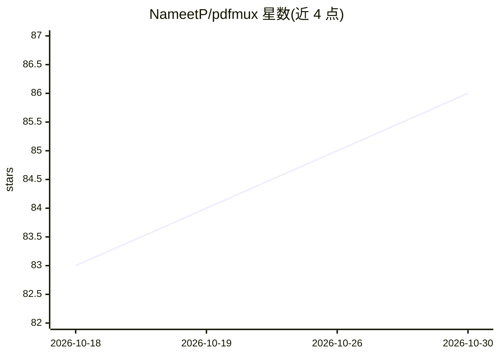

# NameetP/pdfmux

⭐ 86 · Python · MIT · 推送 2026-10-28 · [GitHub](https://github.com/NameetP/pdfmux) · [官网](https://pdfmux.com) · 个人维护

**带自审计的 PDF 提取与校验工具，检出静默丢页**

面向 RAG 管线与 AI agent 的 PDF 提取工具：按页路由到 7 个内置提取后端，附 BYOK LLM 回退（Gemini/Claude/GPT-4o/Ollama），审计置信度并自动用更强后端重提取失败页，仍读不了的页会被标记而非静默丢弃。另提供 pdfmux verify 命令，可对任意提取引擎（Reducto、Mistral OCR、LlamaParse、Docling 等）的输出做对照源 PDF 的校验，输出逐页 PASS/REVIEW/FAIL 与静默丢页清单。支持离线验签 Ed25519 签名清单；验签免费，签名生成属付费云服务。以 pip 包、CLI、Python API 与 7 工具 MCP server 形式提供，需 Python 3.11+。

## 筛选速览

| 维度 | 判定 | 备注 |
|---|---|---|
| AI 角色 | `ai-native` | 本体是模型或模型工具 |
| 许可风险 | `permissive` | MIT |
| 部署形态 | `library` | 以包/库形式分发 |
| 模型依赖 | local-ok | 支持本地模型 |
| 硬件要求 | — | 无带数字的原话,不猜 |
| 安装摩擦 | `medium` | 含编译或系统依赖之一 |
| 成熟度 | — | 结构信号不足 |

## 能力要点

- 按页路由 7 个提取后端 + BYOK LLM 回退，自动重提取失败页
- verify 命令可校验任意引擎输出，定位静默丢页
- 输出逐页置信度/覆盖率/幻觉风险与表格完整性判定
- RAG 分块、schema 预设、watch 模式、成本预估等 CLI 功能

## 适用场景

- RAG 管线中把 PDF 转成干净 Markdown/JSON/分块
- 排查现有提取引擎静默丢页问题
- 通过 MCP 让 Claude Desktop/Cursor 等 agent 读取 PDF

## 场景标签

`文档解析` · 领域:知识与检索

## 证据(README 行号)

> L15: - **Self-healing extraction.** The only PDF extractor that audits its own output. Catches blank pages, scrambled co
> L57: # invoice.pdf -> invoice.md (2 pages, 95% confidence, via pymupdf4llm)
> L172: |MCP server|AI agents read PDFs via stdio or HTTP|`pdfmux serve`|

## 星数曲线

2026-10-18 83 → 2026-10-30 86（+3）

---
*卡片 v1 · prompt 1.4 · 生成 2026-10-24 · 置信度 mid · 依据 README sha `d6b93aa756d3` · [字段定义](../../DATASET.md)*
