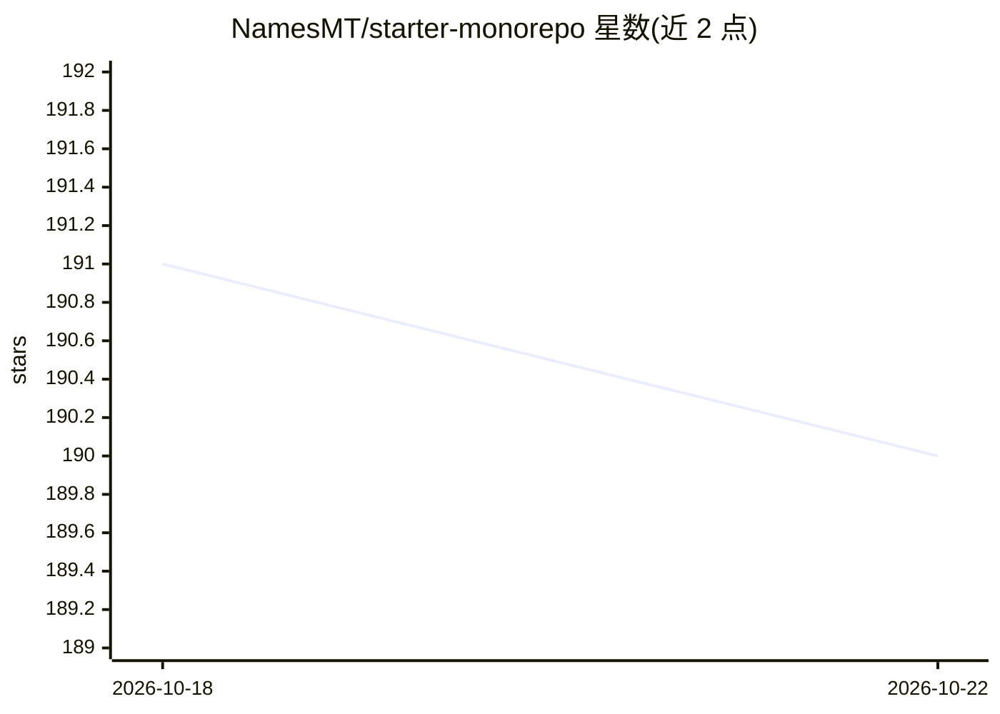

# NamesMT/starter-monorepo

⭐ 190 · Vue · MIT · 推送 2026-10-12 · [GitHub](https://github.com/NamesMT/starter-monorepo) · [官网](https://starter-monorepo.isthe.top) · 个人维护

**含 LLM Chat 功能的全栈 monorepo 起步模板**

基于 Turborepo 的全栈 monorepo 起步模板：前端为 Nuxt 4 应用，主后端为 Hono 应用（可 serverless 部署），另含可选的 Convex 后端。其中 AI 部分：一个面向个人自托管与小群组使用的 LLM Chat 系统，支持 BYOK 接入 OpenAI、OpenRouter 等提供商，具备多用户实时协作、线程分支/冻结/分享、游客匿名使用等特性。还集成 WorkOS AuthKit 认证、SST Ion 基础设施即代码、lingo.dev AI 自动本地化，并提供 AI Agent 初始化提示。需 pnpm 运行开发。

## 筛选速览

| 维度 | 判定 | 备注 |
|---|---|---|
| AI 角色 | `ai-enhanced` | 去掉 AI 部分产品仍成立 |
| 许可风险 | `permissive` | MIT |
| 部署形态 | `library` | 以包/库形式分发 |
| 模型依赖 | — | README 未给出锁定关系 |
| 硬件要求 | — | 无带数字的原话,不猜 |
| 安装摩擦 | `low` | 无编译、无系统依赖或容器化 |
| 成熟度 | — | 结构信号不足 |

## 能力要点

- LLM Chat 系统：BYOK 接入 OpenAI/OpenRouter 等提供商，多用户实时、线程分支与分享
- Nuxt 4 前端 + Hono 主后端 + 可选 Convex 后端的 monorepo 结构
- WorkOS AuthKit 认证样板与 SST Ion 部署配置
- lingo.dev 驱动的 AI 自动本地化（pnpm run i18n）

## 适用场景

- 快速搭建可自托管的全栈项目骨架
- 为家人/朋友小群组自托管一个 LLM Chat 服务
- 以模板为基础扩展多前端与多后端的 monorepo 工程

## 场景标签

`聊天机器人` · 领域:对话与助手

## 证据(README 行号)

> L12: This is an **opinionated, heavily tweaked** monorepo starter template to kick-start a project, whether its a fullst
> L44: #### AI / LLM Chat
> L46: > The focus of the project is for broad, easy personal self-host and family/friends group-use adoption, prioritizin

## 星数曲线

2026-10-18 191 → 2026-10-22 190（-1）

---
*卡片 v1 · prompt 1.4 · 生成 2026-10-22 · 置信度 mid · 依据 README sha `6273ae2e853d` · [字段定义](../../DATASET.md)*
