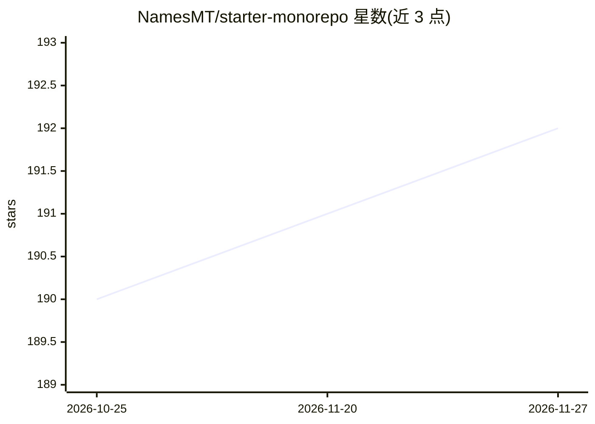

# NamesMT/starter-monorepo

⭐ 192 · TypeScript · MIT · 推送 2026-10-27 · [GitHub](https://github.com/NamesMT/starter-monorepo) · [官网](https://starter-monorepo.isthe.top) · 个人维护

**带自托管 LLM Chat 的全栈 Monorepo 启动模板**

一个包含预设配置的 monorepo 启动模板，内含 Nuxt 4 前端、Hono 主后端与可选的 Convex 后端，通过 Turborepo 组织，提供 WorkOS AuthKit 认证样板、SST Ion 基础设施即代码、Cloudflare Workers/Lambda 部署预设与电子表格驱动的 AI 自动 i18n。核心 AI 组件为可自托管的 LLM Chat：支持自控计费的 hosted provider 与 BYOK 接入，多用户实时同线程对话、线程分支/冻结/分享、流式恢复（轮询实现以简化基础设施）。Convex 后端的定时任务每日清空全部聊天记录以控制演示成本。

## 筛选速览

| 维度 | 判定 | 备注 |
|---|---|---|
| AI 角色 | `ai-enhanced` | 去掉 AI 部分产品仍成立 |
| 许可风险 | `permissive` | MIT |
| 部署形态 | `library` | 以包/库形式分发 |
| 模型依赖 | — | README 未给出锁定关系 |
| 硬件要求 | — | 无带数字的原话,不猜 |
| 安装摩擦 | `low` | 无编译、无系统依赖或容器化 |
| 成熟度 | — | 结构信号不足 |

## 能力要点

- 自托管 LLM Chat：hosted provider 自控计费 + OpenAI/OpenRouter 等 BYOK
- 实时多 agent、多用户同线程对话，支持流式恢复与追问
- Turborepo 组织：Nuxt 4 + Hono + Convex，附 Cloudflare/Lambda 部署预设
- lingo.dev 驱动的 AI 自动本地化，pnpm run i18n 一键执行

## 适用场景

- 为自己和家人朋友自托管一个免费云套餐可跑的 LLM 聊天站
- 以此为模板快速启动全栈 monorepo 项目
- 用 AI Agent 按需改造 monorepo 初始化自己的项目

## 场景标签

`聊天机器人` · 领域:对话与助手

## 证据(README 行号)

> L12: This is an **opinionated, heavily tweaked** monorepo starter template to kick-start a project, whether its a fullst
> L44: #### AI / LLM Chat
> L46: > The focus of the project is for broad, easy personal self-host and family/friends group-use adoption, prioritizin

## 星数曲线

2026-10-25 190 → 2026-11-27 192（+2）

---
*卡片 v1 · prompt 1.4 · 生成 2026-11-26 · 置信度 mid · 依据 README sha `9b9062d619c9` · [字段定义](../../DATASET.md)*
