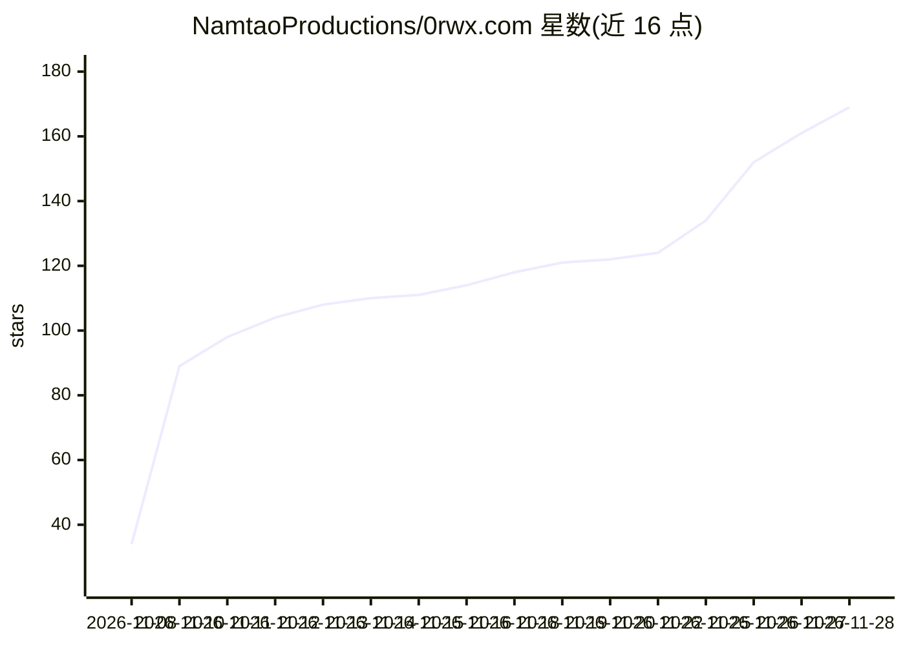

# NamtaoProductions/0rwx.com

⭐ 169 · HTML · 推送 2026-11-22 · [GitHub](https://github.com/NamtaoProductions/0rwx.com) · [官网](https://namtaoproductions.github.io/0rwx.com/) · 个人维护

**声明 PR/代码中 LLM 使用程度的 AI 徽章规范网站**

0rwx.com 的源码仓库，定义一套 AI 使用披露记号：AI:0（未用 LLM）、AI:R（阅读）、AI:W（写作）、AI:X（执行）等，配合 I think/I make/I fix/I curate 的人类创作声明。README 展示在 GitHub PR 中以表格 NOTE 形式嵌入徽章的用法，并可自定义文案（如 AI:1 部分使用、AI:X 由 Claude Code 生成）。本质是社区约定网站，Issues 和 PR 欢迎，但明确不接受 AI 提交。

## 筛选速览

| 维度 | 判定 | 备注 |
|---|---|---|
| AI 角色 | `ai-knowledge` | 知识聚合/清单类 |
| 许可风险 | `none` | — |
| 部署形态 | `None` |  |
| 模型依赖 | — | README 未给出锁定关系 |
| 硬件要求 | — | 无带数字的原话,不猜 |
| 安装摩擦 | `low` | 无编译、无系统依赖或容器化 |
| 成熟度 | — | 结构信号不足 |

## 能力要点

- 定义 AI:0/AI:R/AI:W/AI:X 四级 LLM 使用披露记号
- 提供可直接复制的 PR 徽章 Markdown 代码
- 支持自定义披露文案模板

## 适用场景

- 在开源 PR 中声明自己是否以及如何使用了 LLM
- 项目维护者向社区传递人类/AI 创作比例信号

## 场景标签

 · 领域:开发者工具/社区规范

## 证据(README 行号)

> L1: The code for 0rwx.com. Issues and PRs welcome, no AI please!
> L36: > | AI:0 | AI:0 I've not used an LLM for any part of this PR, this includes any related work like research. |

## 星数曲线

2026-11-08 34 → 2026-11-28 169（+135）

---
*卡片 v1 · prompt 1.4 · 生成 2026-11-17 · 置信度 high · 依据 README sha `8f2098266339` · [字段定义](../../DATASET.md)*
