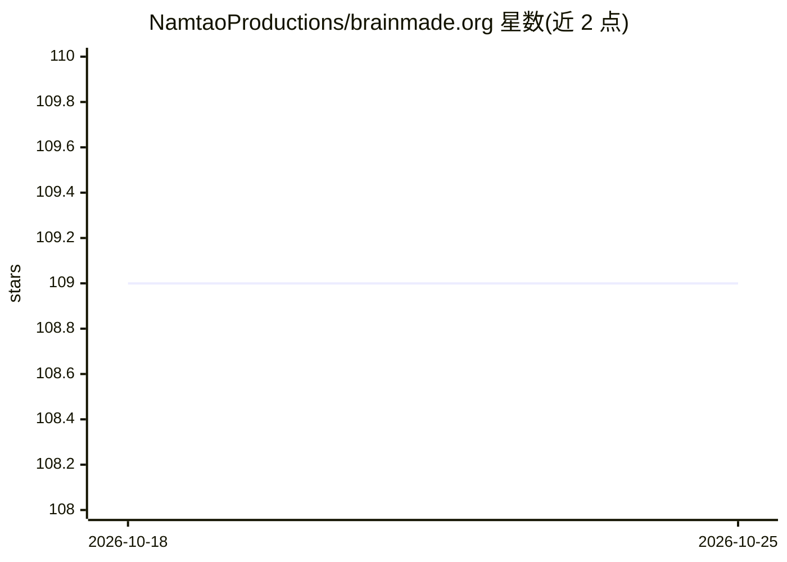

# NamtaoProductions/brainmade.org

⭐ 109 · HTML · CC0-1.0 · 推送 2026-09-30 · [GitHub](https://github.com/NamtaoProductions/brainmade.org) · [官网](https://brainmade.org) · 个人维护

**标注作品由人类创作的 Brainmade 标志与项目清单网站**

提供高分辨率黑白两版 Brainmade 标志的免费下载，供创作者附在自己的作品上，声明该作品主要由人类而非 GPT 等生成式工具完成。网站同时维护一份经社区验证的、使用该标志的项目清单，并提供 shields.io 徽章版本。面向希望公开声明作品人类创作属性的创作者。

## 筛选速览

| 维度 | 判定 | 备注 |
|---|---|---|
| AI 角色 | `ai-knowledge` | 知识聚合/清单类 |
| 许可风险 | `viral` | CC0-1.0 |
| 部署形态 | `None` |  |
| 模型依赖 | — | README 未给出锁定关系 |
| 硬件要求 | — | 无带数字的原话,不猜 |
| 安装摩擦 | `low` | 无编译、无系统依赖或容器化 |
| 成熟度 | — | 结构信号不足 |

## 能力要点

- 免费提供高分辨率黑白两版标志下载
- 维护经社区验证的使用该标志的项目清单
- 提供 shields.io 徽章版本

## 适用场景

- 在我的画作、诗歌或文章上附上标志声明人类创作
- 查看其他使用该标志的项目
- 在项目 README 中使用徽章表明非生成式工具创作

## 场景标签

`精选清单` · 领域:学习与行业

## 证据(README 行号)

> L1: Brainmade.org maintains a list of projects using the mark, validated by the community.
> L9: The Brainmade mark, here, is something I will be attaching to any works of mine that were mostly made by me or my fr

## 星数曲线

2026-10-18 109 → 2026-10-25 109（+0）

---
*卡片 v1 · prompt 1.4 · 生成 2026-10-23 · 置信度 mid · 依据 README sha `297b69913c21` · [字段定义](../../DATASET.md)*
