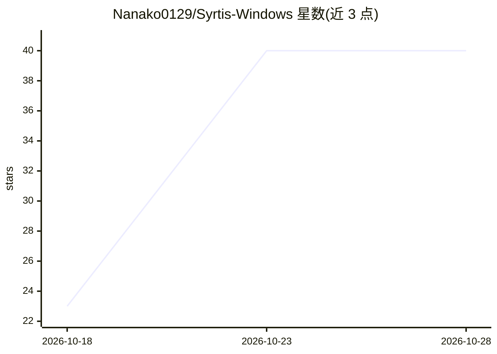

# Nanako0129/Syrtis-Windows

⭐ 40 · C# · MIT · 推送 2026-10-26 · [GitHub](https://github.com/Nanako0129/Syrtis-Windows) · 个人维护 · 中文 README

**Windows 托盘监控器：追踪 AI 编程 agent 的 token 用量、费用与配额**

TokenBar 的 Windows 移植版：Rust 解析核心（tokscale-core）加 WinUI 3 外壳。读取 Claude、Codex、GitHub Copilot、Grok、Kiro、Antigravity 等 agent CLI 已登录的本地凭据，展示用量、费用与订阅配额，含八个面板（总览/配额/模型/月/日/时/统计/Agent）、七种托盘图标显示模式、D3D11 渲染的 3D 贡献图与应用内更新。安装提供 x64/ARM64 安装包与 Scoop 渠道。已知限制：尚缺 macOS 版的部分功能（Discord Rich Presence、简体中文、多账号 Claude 等）。

## 筛选速览

| 维度 | 判定 | 备注 |
|---|---|---|
| AI 角色 | `ai-ecosystem` | LLM/agent 周边工具 |
| 许可风险 | `permissive` | MIT |
| 部署形态 | `desktop` | 安装包/桌面程序 |
| 模型依赖 | locked-api |  |
| 硬件要求 | — | 无带数字的原话,不猜 |
| 安装摩擦 | `high` | 编译与系统依赖俱全 |
| 成熟度 | — | 结构信号不足 |

## 能力要点

- 读取 7 种 agent CLI 的本地登录凭据追踪配额
- 八面板托盘监控（配额热图、逐客户端历史、Agent 限额视图）
- Rust 核心 + WinUI 3 外壳，x64/ARM64 安装包与 Scoop 分发
- D3D11 实时 3D 贡献图与 Velopack 应用内更新

## 适用场景

- 我在用多个 AI 编程 CLI，想在一个托盘里看 token 用量和剩余配额
- 按月/日/小时查看 AI 编程花费趋势
- 接近订阅限额时通过托盘图标余量提醒控制节奏

## 场景标签

 · 领域:开发者工具/AI 用量监控

## 证据(README 行号)

> L72: The app reads quota for seven agent CLIs, using credentials already written to disk by a login
> L25: - **Tray icon**, seven display modes (today/total tokens, today/total cost, tokens-per-minute,

## 星数曲线

2026-10-18 23 → 2026-10-28 40（+17）

---
*卡片 v1 · prompt 1.4 · 生成 2026-10-25 · 置信度 high · 依据 README sha `1def511a3f5a` · [字段定义](../../DATASET.md)*
