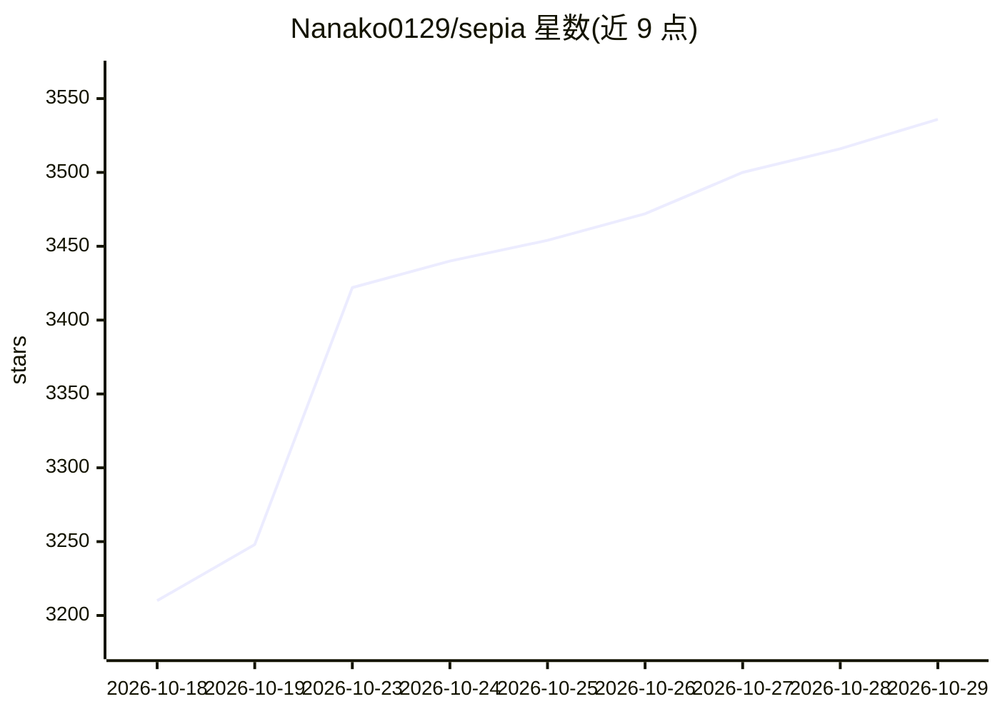

# Nanako0129/sepia

⭐ 3,536 · Python · MIT · 推送 2026-10-15 · [GitHub](https://github.com/Nanako0129/sepia) · 个人维护 · 中文 README

**面向 Agent 的去 AI 味写作技能包，修复叙事结构与文体**

一个可移植的 Agent Skill（单一 SKILL.md）：通过支持 77+ agent 的 Skills CLI 一条命令安装，Claude Code、Codex、Grok Build、Antigravity、QwenPaw 获得原生插件封装。基于 StoryScope 研究的叙事结构层检测发现，对小说先修叙事架构再做话语与表层风格的三遍修订；对发布说明、PR 回复、故障复盘等职业文体按场合配规则文件。提供 write/review/refactor/recreate 四种操作与 30 项诊断量表，另支持叠加声线技能（Hemingway、台湾长文等）与中文校准。不支持独立 wrapper 安装，依赖宿主 agent。

## 筛选速览

| 维度 | 判定 | 备注 |
|---|---|---|
| AI 角色 | `ai-native` | 本体是模型或模型工具 |
| 许可风险 | `permissive` | MIT |
| 部署形态 | `library` | 以包/库形式分发 |
| 模型依赖 | locked-api |  |
| 硬件要求 | — | 无带数字的原话,不猜 |
| 安装摩擦 | `low` | 无编译、无系统依赖或容器化 |
| 成熟度 | — | 结构信号不足 |

## 能力要点

- 单一 SKILL.md 跨 77+ agent 安装，五个平台原生插件封装
- write/review/refactor/recreate 四操作 + 30 项诊断量表
- 三遍修订协议：叙事架构→话语流→表层风格
- 按文体场合（发布说明/PR/复盘/报道等）配规则，含中文证据校准

## 适用场景

- 让写作 agent 生成或修订小说时去除叙事结构层面的 AI 特征
- 撰写符合场合规范的技术文档、PR 回复与故障复盘
- 诊断已有文本的 AI 痕迹并做最小限度修订

## 场景标签

`AI 写作` · 领域:内容生成

## 证据(README 行号)

> L9: A portable Agent Skill: any agent that speaks the standard can load it, and the Skills CLI, which supports 77+ agent
> L15: Every popular humanizer edits word choice and syntax. StoryScope (Russell et al., 2026: 61,608 stories, human + 5 f
> L52: The complete plugin package gives Claude Code, Codex, Grok Build, Antigravity, and QwenPaw a general router plus fi

## 星数曲线

2026-10-18 3,210 → 2026-10-29 3,536（+326）

---
*卡片 v1 · prompt 1.4 · 生成 2026-10-20 · 置信度 high · 依据 README sha `f29fa8830c48` · [字段定义](../../DATASET.md)*
