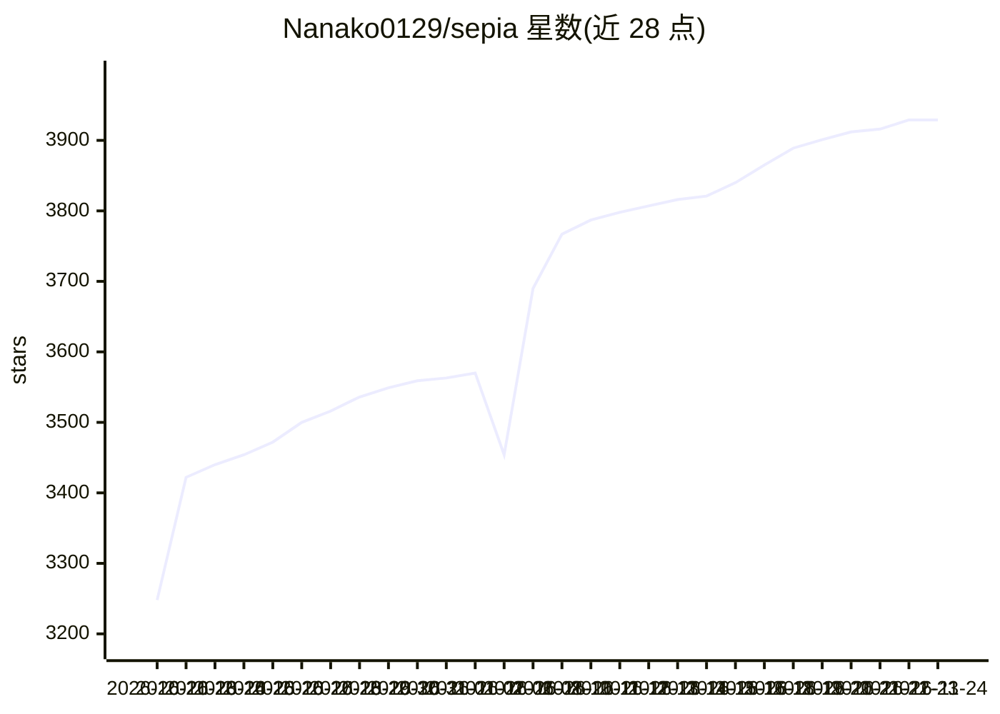

# Nanako0129/sepia

⭐ 3,929 · Python · MIT · 推送 2026-11-03 · [GitHub](https://github.com/Nanako0129/sepia) · 个人维护 · 中文 README

**给 Agent 兼容 agent 用的去 AI 味写作技能包**

一个可移植的 Agent Skill（SKILL.md 格式），为兼容该标准的 agent 提供去 AI 味写作与改写协议；由 Skills CLI 一条命令安装，官方称支持 77+ agents，另为 Claude Code、Codex、Grok Build、Antigravity、QwenPaw 提供原生插件包。小说走三遍式修改：先修叙事架构、再修语篇流、最后修表层文风；专业文体（发布说明、PR 回复、复盘、工单、技术文章等）各有对应场所的规则文件。四个操作：write、review、refactor、recreate，另有可选的 voice/persona 声音叠加接口与中文句长节奏校准。

## 筛选速览

| 维度 | 判定 | 备注 |
|---|---|---|
| AI 角色 | `ai-native` | 本体是模型或模型工具 |
| 许可风险 | `permissive` | MIT |
| 部署形态 | `library` | 以包/库形式分发 |
| 模型依赖 | — | README 未给出锁定关系 |
| 硬件要求 | — | 无带数字的原话,不猜 |
| 安装摩擦 | `low` | 无编译、无系统依赖或容器化 |
| 成熟度 | — | 结构信号不足 |

## 能力要点

- 单一 SKILL.md，Skills CLI 一条命令安装，支持 77+ agents
- 小说三遍式协议：叙事架构→语篇流→表层文风
- 按模型家族（Claude/GPT/Gemini/DeepSeek/Kimi）的指纹诊断规则
- 可选 voice/persona 叠加接口与中文校准文件（references/languages/zh.md）

## 适用场景

- 改写小说，去除叙事层面的 AI 痕迹后再调文风
- 按发布说明、复盘、工单等文体的场所规则润色专业文档
- 在 Claude Code 等宿主中用 /sepia-write 等命令直接产出或修订文本
- 为中文文本按句长节奏与语料校准做去 AI 味处理

## 场景标签

`AI 写作` · 领域:内容生成

## 证据(README 行号)

> L9: A portable Agent Skill: any agent that speaks the standard can load it, and the Skills CLI, which supports 77+ agent
> L17: sepia turns those measured gaps, together with the related studies digested in `research/`, into a three-pass writi
> L115: python3 scripts/check_persona.py <file>

## 星数曲线

2026-10-21 3,248 → 2026-11-24 3,929（+681）

---
*卡片 v1 · prompt 1.4 · 生成 2026-11-23 · 置信度 high · 依据 README sha `67bed0c2c4ee` · [字段定义](../../DATASET.md)*
